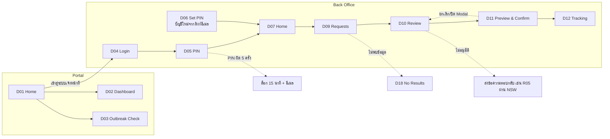

# 🖥️ รายละเอียดหน้าจอ (จาก Figma)

อ้างอิง: [Figma — DDC e-Pinkforms › 05 · Web Desktop Screens](https://www.figma.com/design/O1QKAG1dNDQ7DROItvmJhU/DDC-e-Pinkforms?node-id=3-6) (Light mode, 1440px)
Token สี / ฟอนต์ / ขนาด ดู [flamework.md](flamework.md) · ภาพรวมระบบและ TOR ดู [system-overview.md](system-overview.md)

> ข้อมูลในตารางตัวอย่าง (ชื่อบริษัท เลขที่ จำนวน) เป็นข้อมูลจำลองใน Figma ใช้เป็น mock data ของ Prototype ได้

---

# 🧭 User Flow (Figma › 03 · User Flow)

เมนู Sidebar เข้าได้จาก D07: D08 Operators, D13 Payments, D14 Outbreak Areas, D15 Users & Roles, D16 ebXML, D17 PKI
Mobile: S01 Home → S02 Outbreak Check

---

# 🧩 ส่วนที่ใช้ร่วมกัน

## Portal (D01 – D03)

- **Header** (ขาว): โลโก้ "DDC e-**Pinkforms**" + "กรมควบคุมโรค กระทรวงสาธารณสุข"
  - เมนู: หน้าแรก · ข่าวประชาสัมพันธ์ · Dashboard · พื้นที่โรคระบาด · กฎหมายที่เกี่ยวข้อง · แบบสอบถาม
  - ปุ่มขวา "เข้าสู่ระบบเจ้าหน้าที่" (ไอคอนกุญแจ)
- **Page Hero** (teal เข้ม): breadcrumb + หัวข้อ + คำอธิบาย (หน้าในเท่านั้น)
- **Footer** (teal เข้ม) 4 คอลัมน์
  - โลโก้ + ที่อยู่ "กรมควบคุมโรค กระทรวงสาธารณสุข ถนนติวานนท์ ตำบลตลาดขวัญ อำเภอเมือง จังหวัดนนทบุรี 11000"
  - บริการ: ขั้นตอนการขอใบรับรองฯ, ตรวจสอบพื้นที่โรคระบาด, Dashboard สถิติ
  - ข้อมูล: กฎหมายที่เกี่ยวข้อง, คู่มือการใช้งาน, แบบสอบถามความพึงพอใจ
  - ติดต่อเรา: โทร, อีเมล, เวลาทำการ จันทร์ – ศุกร์ 08:30 – 16:30 น.
  - แถบล่าง: "© 2569 กรมควบคุมโรค · นโยบายคุกกี้ · นโยบายความเป็นส่วนตัว" + **ตัวนับผู้เข้าชม** "ผู้เข้าชมทั้งหมด 1,284,553 ครั้ง · วันนี้ 1,042"

## Back Office (D07 – D18)

**Sidebar** (264px, `#073B47`)
- โลโก้ + "กรมควบคุมโรค กระทรวงสาธารณสุข"
- เมนูตามกลุ่ม:

| กลุ่ม       | เมนู                                                                                 |
| ---------- | ------------------------------------------------------------------------------------ |
| ภาพรวม     | หน้าหลัก                                                                              |
| งานบริการ  | ทะเบียนผู้ประกอบการ · พิจารณาอนุมัติ THNSW `5` · คำขอใบรับรองฯ `12` · ติดตามสถานะคำขอ · ข้อมูลใบรับรองฯ |
| การเงิน     | ติดตามการชำระเงิน · ใบเสร็จรับเงิน                                                       |
| ข้อมูลหลัก  | พื้นที่โรคระบาด · ข้อมูลหลักอื่น ๆ                                                        |
| รายงาน     | รายงานสรุป                                                                            |
| ผู้ดูแลระบบ | ผู้ใช้งานและสิทธิ์ · ติดตาม ebXML · ใบรับรอง PKI · Audit Log                                |

- Badge จำนวนงาน: สีชมพู
- เมนู active: พื้นอ่อนกว่า + แถบชมพูขอบซ้าย + ตัวหนา
- ท้าย Sidebar: "เวอร์ชัน 1.0 (Prototype) · กองโรคติดต่อทั่วไป"

**Topbar** (72px)
- breadcrumb
- ช่องค้นหา "ค้นหา Reference No. / บริษัท"
- กระดิ่ง (จุดแดงเมื่อมีแจ้งเตือน)
- Avatar + ชื่อ + ตำแหน่ง + dropdown

**รูปแบบหน้า**
- หัวข้อ (H2) + คำอธิบาย ด้านซ้าย / ปุ่มหลักด้านขวา
- **Pagination**: "แสดง 1 – N จาก M รายการ" · "แสดง [20 ▾] รายการ/หน้า" · `< 1 2 3 >`
- **ปุ่มในคอลัมน์จัดการ**: ไอคอน ตา (ดู) · ดินสอ (แก้ไข) · ถังขยะ (ลบ)

**ผู้ใช้ตัวอย่างใน Figma**

| ชื่อ          | บทบาท                     |
| ------------ | ------------------------- |
| สมฤดี ใจดี    | ฝ่ายบริการ                  |
| สมชาย ระวังภัย | ฝ่ายบริการ                  |
| ประภาพร มั่นคง | ฝ่ายการเงิน                 |
| ธนกร ศรีสุข    | Admin · IT                |
| วิภาวรรณ ทองดี | ผู้มีอำนาจลงนาม              |

## Badge สถานะ (สีที่ใช้)

| สี     | ความหมาย / ตัวอย่าง                                                              |
| ------ | ------------------------------------------------------------------------------- |
| เขียว  | ผ่าน, ถูกต้อง, ใช้งาน, ชำระแล้ว, เชื่อมต่อ, สำเร็จ, Good, ออนไลน์, ปลอดโรคแล้ว, ตั้งแล้ว |
| ส้ม    | รอพิจารณา, รอการชำระเงิน, ตรวจพบ 1 รายการ, พื้นที่เฝ้าระวัง, ตอบช้า, Retry 2 / 5, ใกล้หมดอายุ |
| แดง    | ไม่สำเร็จ, ระงับชั่วคราว, ไม่ผ่าน, Error: Signature, Timeout, ยังไม่ปลอดโรค · อีก N วัน   |
| น้ำเงิน | อยู่ระหว่างดำเนินการ, รับข้อมูลใบคำขอ, รอ ACK, ทิศทาง "รับ", บทบาท User                 |
| ชมพู   | สถานะปัจจุบัน (แจ้งสถานะพร้อมจ่าย), ทิศทาง "ส่ง", บทบาท Admin, tab active               |
| เทา    | ยังไม่ตั้ง, ระงับ (ผู้ใช้), รอ, chip ประเภทกิจการ                                      |

---

# 🌐 Portal

## D01 · Portal / Home — `P-01`

**ลำดับส่วนในหน้า**
1. Header
2. Hero
3. การ์ดสถิติ
4. ขั้นตอนการขอใบรับรองฯ
5. ข่าวประชาสัมพันธ์
6. Quick Links
7. Footer
8. Cookie Banner

**Hero**
- Tag "บริการอิเล็กทรอนิกส์ผ่าน National Single Window"
- หัวข้อ "ใบรับรองแหล่งผลิต / แหล่งกำเนิดอาหารปลอดโรค / (**Pinkforms**)"
- คำอธิบาย "ยื่นคำขอ ชำระค่าบริการ และรับใบรับรองฯ แบบไร้เอกสาร เพื่อใช้ประกอบพิธีการศุลกากรสำหรับการส่งออกอาหาร ผัก และผลไม้"
- ปุ่ม: "ขั้นตอนการขอใบรับรองฯ >" (ชมพู) · "ตรวจสอบพื้นที่โรคระบาด" (ขาว)
- ภาพประกอบใบรับรองจำลอง และการ์ดลอย "ออกใบรับรองฯ เรียบร้อย" / "ส่งข้อมูลผ่าน National Single Window"

**การ์ดสถิติ** (วางซ้อนขอบล่างของ Hero)

| ตัวเลข  | คำอธิบาย                 |
| ------- | ------------------------ |
| 18,452  | ใบรับรองฯ ที่ออกในปี 2569   |
| 1,236   | ผู้ประกอบการที่ลงทะเบียน     |
| 42      | ประเทศปลายทาง            |
| < 1 วัน | ระยะเวลาดำเนินการเฉลี่ย     |

**ขั้นตอนการขอใบรับรองฯ** — "ผู้ประกอบการดำเนินการผ่านระบบ NSW ไม่ต้องเดินทางมายื่นเอกสาร"
- 01 ลงทะเบียนผู้ใช้บริการ
- 02 ยื่นคำขอผ่าน NSP
- 03 ชำระค่าบริการ
- 04 รับใบรับรองฯ

**ข่าวประชาสัมพันธ์**
- การ์ดข่าว 3 ใบ: ภาพ, badge หมวด (ประชาสัมพันธ์ / ประกาศ / อบรม), วันที่, หัวเรื่อง, ลิงก์ "อ่านต่อ >"
- ลิงก์ "ดูทั้งหมด >"

**Quick Links**
- กฎหมายที่เกี่ยวข้อง
- คู่มือการใช้งาน
- แบบสอบถาม
- ติดต่อเจ้าหน้าที่

**Cookie Banner**
- "เว็บไซต์นี้ใช้คุกกี้ เพื่อพัฒนาการให้บริการและนับจำนวนผู้เข้าชม ท่านสามารถเลือกยอมรับหรือปฏิเสธคุกกี้ที่ไม่จำเป็นได้ อ่านนโยบายคุกกี้"
- ปุ่ม: ตั้งค่าคุกกี้ · ปฏิเสธ · ยอมรับทั้งหมด

## D02 · Portal / Dashboard – Monthly — `P-02`

- **หัวข้อ**: "Dashboard สถิติใบรับรองฯ" · "อัปเดตล่าสุด 26 ต.ค. 2569 11:00 น."
- **ตัวกรอง**:
  - ช่วงข้อมูล (segmented): รายเดือน / รายปี / ย้อนหลัง 5 ปี
  - Dropdown ปี พ.ศ.
  - Dropdown ทุกประเภทสินค้า
  - ปุ่ม "ดาวน์โหลดข้อมูล"
- **KPI**:
  - จำนวนการยื่นคำขอ 19,110 (▲ 6.2% เทียบช่วงเดียวกันปีก่อน)
  - ใบรับรองฯ ที่ออกแล้ว 18,452 (96.6%)
  - ผู้ประกอบการที่ขอใบรับรองฯ 1,236 (ลงทะเบียน 1,018)
  - ประเทศปลายทาง 42
- **กราฟ**:
  - กราฟแท่งคู่ "จำนวนคำขอและใบรับรองฯ รายเดือน" (คำขอ teal / ใบรับรองฯ ชมพู)
  - อันดับ "ใบรับรองฯ ตามประเทศผู้รับสินค้าปลายทาง" (8 อันดับ + progress bar)
  - อันดับ "สินค้าที่ส่งออกมากที่สุด" (6 อันดับ)
  - Donut "ผู้ประกอบการที่ขอใบรับรองฯ" แยก ลงทะเบียนโดยตรง 1,018 / ร่วมผูกสัมพันธ์ (ตัวแทน) 218
  - กราฟแท่ง "พื้นที่โรคระบาดย้อนหลัง 5 ปี" (2565–2569, หน่วย: จำนวนตำบล)

## D03 · Portal / Outbreak Check – Result Found — `P-03`

- **หัวข้อ**: "ตรวจสอบข้อมูลพื้นที่โรคระบาด" · "ตรวจสอบแหล่งผลิตก่อนยื่นคำขอใบรับรองฯ · ข้อมูลจากกองระบาดวิทยา กรมควบคุมโรค"
- **ค้นหา**: dropdown ต่อเนื่อง จังหวัด → อำเภอ → ตำบล + ปุ่ม "ตรวจสอบ"
- **กล่องผลลัพธ์** (ชมพูอ่อน ไอคอนเตือนแดง)
  - "ต.ท่าช้าง อ.เมืองจันทบุรี จ.จันทบุรี — อยู่ในพื้นที่โรคระบาด"
  - "พบรายงานโรคระบาดเมื่อ 12/10/2569 · คาดว่าจะปลอดโรคในวันที่ 02/11/2569 (นับจากวันที่เกิดโรค 21 วัน)"
  - กล่องตัวเลขด้านขวา "7 วันจะปลอดโรค"
- **ตาราง "พื้นที่ที่ยังไม่ปลอดโรคระบาด"** (badge "3 พื้นที่")
  - คอลัมน์: # · จังหวัด · อำเภอ · ตำบล · วันที่เกิดโรค · วันที่ปลอดโรค · สถานะ ("อีก N วัน")
  - หมายเหตุใต้ตาราง: "พื้นที่จะถูกนำออกจากรายการโดยอัตโนมัติเมื่อครบกำหนดวันที่ปลอดโรคระบาด"
- **กราฟ "สถิติพื้นที่โรคระบาด"**: รายเดือน / รายปี / ย้อนหลัง 5 ปี, เทียบปี 2569 (ชมพู) กับ 2568 (เทา)

## S01 / S02 · Mobile — `P-01M`, `P-03`

- ความกว้าง 390 (ทดสอบ 360 / 430)
- เนื้อหาเหมือน D01 และ D03 ในรูปแบบมือถือ

---

# 🔐 เข้าสู่ระบบ

**Layout ร่วม (D04 – D06)** แบ่งจอ 2 ส่วน
- ซ้าย: Branding panel (640px, teal เข้ม)
  - หัวข้อ "ระบบบริการใบรับรองแหล่งผลิต แหล่งกำเนิดอาหารปลอดโรค"
  - Badge "ระบบหลังบ้านสำหรับเจ้าหน้าที่"
  - จุดเด่น 3 ข้อ: ลายมือชื่อดิจิทัล PKI · เชื่อมโยง NSW (ebMS 2.0) · ยืนยันตัวตน 2 ชั้น
- ขวา: ฟอร์ม (กว้างประมาณ 480px)

## D04 · Admin / Login – Credentials — `B-01`

- **Stepper**: ① Username / Password → ② PIN 6 หลัก
- **หัวข้อ**: "เข้าสู่ระบบ" · "สำหรับเจ้าหน้าที่กรมควบคุมโรค"
- **ช่องกรอก**:
  - ชื่อผู้ใช้ (Username) — ไอคอนคน
  - รหัสผ่าน (Password) — ไอคอนกุญแจ + ปุ่มแสดง/ซ่อนรหัส
  - Checkbox "จดจำชื่อผู้ใช้"
  - ลิงก์ "ลืมรหัสผ่าน?"
- **ปุ่ม**: "ถัดไป >" (เต็มความกว้าง)
- **ข้อความท้ายฟอร์ม**: "ระบบบันทึกประวัติการเข้าใช้งาน (IP, เวลา, อุปกรณ์) ตาม พ.ร.บ. คอมพิวเตอร์"

## D05 · Admin / Login – PIN — `B-01.2`

- **หัวข้อ**: "กรอก PIN 6 หลัก" · "ยืนยันตัวตนชั้นที่ 2 สำหรับบัญชี somrudee.j"
- **ช่อง PIN**: 6 ช่อง แสดงเป็นจุด, ช่องปัจจุบันมีกรอบ focus
- **ใต้ช่อง PIN**: "กรอกผิดได้อีก 5 ครั้ง" · ลิงก์ "ลืม PIN?"
- **แป้นตัวเลข** 3×4 สุ่มตำแหน่งทุกครั้ง, แถวล่างมี "ล้าง" และ "⌫"
- **กล่องเตือน**: "กรอก PIN ผิดครบ 5 ครั้ง ระบบจะล็อกบัญชี 15 นาที และส่งอีเมลแจ้งเตือน ปลดล็อกได้ด้วยการตั้ง PIN ใหม่ผ่านอีเมล"
- **ปุ่ม**: "ยืนยันและเข้าสู่ระบบ" · "< กลับไปหน้าเข้าสู่ระบบ"

## D06 · Admin / Set PIN – Confirm (Validation) — `B-01.3`

- **Alert สำเร็จ**: "ยืนยันอีเมลสำเร็จ · s*****@ddc.mail.go.th"
- **Stepper**: ✓ ยืนยันอีเมล → ✓ ตั้งรหัสผ่าน → ③ ตั้ง PIN
- **ช่องกรอก**: "PIN ใหม่" 6 ช่อง และ "ยืนยัน PIN อีกครั้ง" 6 ช่อง
- **Checklist ตรวจแบบ real-time**:
  - ตัวเลข 6 หลัก
  - ไม่ใช่เลขเรียง (123456 / 654321)
  - ไม่ใช่เลขซ้ำ (111111)
  - PIN ทั้ง 2 ช่องตรงกัน
- **กล่องข้อมูล**: "PIN ถูกเข้ารหัสแบบทางเดียว (Hash) ไม่มีผู้ใดเห็นได้ รวมถึงผู้ดูแลระบบ · ลิงก์นี้ใช้ได้ครั้งเดียว และหมดอายุใน 24 ชั่วโมง"
- **ปุ่ม**: "บันทึก PIN และเริ่มใช้งาน" — disabled จนกว่าจะผ่านครบ 4 ข้อ

---

# 🏢 Back Office

## D07 · Admin / Home – Overview — `B-02`

- **หัวข้อ**: "สวัสดี คุณสมฤดี" · "ภาพรวมงานบริการใบรับรองฯ ประจำวันจันทร์ที่ 26 ตุลาคม 2569"
- **ปุ่ม**: "รายงานประจำวัน" (outline) · "ไปที่คำขอรอพิจารณา" (primary)
- **KPI**:
  - คำขอใหม่วันนี้ 18 (▲ 12% จากเมื่อวาน)
  - รอพิจารณา 12 (เก่าที่สุดรอ 2 ชม. 15 นาที)
  - รอการชำระเงิน 7 (Bill Payment ผ่านธนาคาร)
  - ออกใบรับรองฯ เดือนนี้ 426 (▲ 8.4% จากเดือนก่อน)
- **กราฟ**: "จำนวนคำขอและใบรับรองฯ 14 วันล่าสุด" (แท่งคู่ คำขอ / ออกใบรับรองฯ)
- **การ์ด "สถานะคำขอวันนี้"**: รับข้อมูลใบคำขอ · อยู่ระหว่างดำเนินการ · รอการชำระเงิน · ออกใบรับรองแล้ว · ข้อมูลไม่ถูกต้อง / ไม่อนุมัติ (จุดสี + จำนวน)
- **ตาราง "คำขอรอพิจารณา"**
  - ชิป "เรียงตามเวลาที่ยื่น" · ลิงก์ "ดูทั้งหมด >"
  - คอลัมน์: Reference No. · บริษัท · ประเทศ · รายการ · ยื่นเมื่อ
  - คำขอที่รอนานแสดง badge ส้ม "08:42 · 2 ชม."
- **การ์ด "สถานะการเชื่อมโยงระบบ"**:

| ระบบ                    | รายละเอียด             | สถานะ              |
| ----------------------- | --------------------- | ----------------- |
| Thailand NSW            | ebMS 2.0 · ผ่าน GIN   | เชื่อมต่อ (เขียว)    |
| ebXML Gateway           | คิวรอส่ง 2 · Retry 1  | ทำงานปกติ (เขียว)   |
| ธนาคาร A (e-Payment)    | รหัส 006              | เชื่อมต่อ (เขียว)    |
| ธนาคาร B (e-Payment)    | รหัส 014              | ตอบช้า (ส้ม)        |
| กรมศุลกากร e-Licensing   | ส่งข้อมูลล่าสุด 10:21   | เชื่อมต่อ (เขียว)    |

- **Alert**: "ใบรับรอง PKI ใกล้หมดอายุ 2 รายการ — Signer Certificate ของผู้มีอำนาจลงนาม จะหมดอายุใน 21 วัน"

## D08 · Admin / Operators – List — `B-03` (+ tab `B-04`)

- **หัวข้อ**: "ทะเบียนผู้ประกอบการ" · "ข้อมูลผู้ประกอบการที่ขึ้นทะเบียนผ่านระบบ NSW (ผู้ส่งออก / ตัวแทนออกของ / Counter Service)"
- **ปุ่ม**: "ส่งออก Excel" · "+ เพิ่มผู้ประกอบการ"
- **KPI**:
  - ผู้ประกอบการที่ลงทะเบียน 1,236 (ผู้ส่งออก 1,018 ราย)
  - ตัวแทนออกของ 184 (ร่วมผูกสัมพันธ์ 2,481 คู่)
  - รอพิจารณาอนุมัติ 5 (รายการใหม่จาก NSW)
  - ระงับสิทธิ์ 12
- **ตัวกรอง**:
  - เลขประจำตัวผู้เสียภาษี (เลข 13 หลัก)
  - สาขา (00000)
  - ชื่อบริษัท (ไทย / Eng)
  - สิทธิการเข้าใช้งาน (dropdown)
  - ประเภทบริการ (dropdown)
  - ปุ่ม "ค้นหา" · "ล้าง"
- **Tabs**: ผู้ประกอบการ `1,420` · รอพิจารณาอนุมัติ THNSW `5` · ประวัติการแก้ไข
- **ตาราง**:
  - คอลัมน์: เลขผู้เสียภาษี / สาขา · ชื่อบริษัท (ไทย / Eng) · ประเภทกิจการ (chip: ผู้ส่งออก / ตัวแทนออกของ / Counter Service) · ประเภทบริการ (ใบรับรองฯ / ยื่นแทนผู้ส่งออก) · NSW Register ID · สิทธิการเข้าใช้งาน (ใช้งาน / ระงับชั่วคราว) · ยื่นคำขอล่าสุด · จัดการ (ดู / แก้ไข / ลบ)

## D09 · Admin / Requests – Pending List — `B-05`

- **หัวข้อ**: "คำขอใบรับรองฯ" · "รายการคำขอที่ได้รับผ่านระบบ NSW · คำขอที่ยื่นเข้าระบบก่อนแสดงเป็นลำดับแรก"
- **ปุ่ม**: "ส่งออก Excel"
- **ตัวกรอง**:
  - Reference No. / PF-ID
  - เลขประจำตัวผู้เสียภาษี
  - ชื่อบริษัท (ไทย / Eng)
  - Invoice No.
  - วันที่ส่งข้อมูล (ช่วงวันที่)
  - ปุ่ม "ค้นหา" · "ล้าง"
  - เรียงตาม: "เวลาที่ยื่น (เก่า → ใหม่)"
- **Tabs สถานะ**: ทั้งหมด `132` · **รอพิจารณา `12`** · ข้อมูลไม่ถูกต้อง `3` · อนุมัติแล้ว `96` · ไม่อนุมัติ `4` · รอการชำระเงิน `7`
- **ตาราง**:
  - คอลัมน์: Reference No. · วันที่ส่งข้อมูล (วันที่ + เวลา) · Invoice No. · ชื่อบริษัท · Brandname · ประเทศ · จำนวน · **ตรวจสอบอัตโนมัติ** (ผ่าน / ตรวจพบ N รายการ) · สถานะ · View
  - แสดง 20 รายการ/หน้า

## D10 · Admin / Request Review – Checklist Incomplete — `B-06`

- **Breadcrumb**: งานบริการ / คำขอใบรับรองฯ / PF6910260003
- **หัวข้อ**: "พิจารณาคำขอใบรับรองฯ" · "ตรวจสอบรายละเอียดคำขอ ทำเครื่องหมายรายการตรวจสอบ และบันทึกผลการพิจารณา"
- **ปุ่ม**: "< กลับไปรายการคำขอ"
- **การ์ดสรุป**
  - Reference No. · ผู้ยื่นคำขอ · ยื่นผ่าน (NSP) · วันที่ส่งข้อมูล
  - Badge "อยู่ระหว่างดำเนินการ" และ "ลายมือชื่อดิจิทัลถูกต้อง"

**คอลัมน์ซ้าย**
- **Tabs**: ข้อมูลคำขอ · รายการสินค้า `4` · เอกสารประกอบ `3` · ประวัติสถานะ · XML ต้นฉบับ
- **ข้อมูลคำขอ**
  - ผู้ส่งออก (Exporter): ชื่อบริษัท ไทย/Eng · เลขผู้เสียภาษี / สาขา · Brandname · Invoice No. (วันที่)
  - ผู้รับสินค้า (Consignee): ชื่อผู้รับ · ประเทศ · ท่าขนถ่าย (THLCH แหลมฉบัง → TWKHH Kaohsiung) · วิธีการขนส่ง
- **ตาราง "รายการสินค้า"**
  - ชิป "ตรวจสอบอัตโนมัติ 26/10/2569 08:42" · badge "พบ 1 รายการที่ต้องตรวจสอบ"
  - คอลัมน์: # · ชื่อสินค้า (ไทย / อังกฤษ) · พิกัดศุลกากร · แหล่งผลิต · วันที่ผลิต · จำนวน · ผลตรวจ (ถูกต้อง / พื้นที่เฝ้าระวัง)
  - Alert: "รายการที่ 3 แหล่งผลิต ต.ท่าช้าง อ.เมืองจันทบุรี อยู่ในพื้นที่ที่มีรายงานโรคระบาดเมื่อ 12/10/2569 · ปลอดโรคตั้งแต่ 02/11/2569 (คำนวณ +21 วัน)"

**คอลัมน์ขวา**
- **Checklist "รายการตรวจสอบก่อนอนุมัติ"** (badge 4 / 6 + progress bar)
  1. ข้อมูลผู้ประกอบการตรงกับที่ลงทะเบียน
  2. ชื่อสินค้าและลักษณะนามถูกต้อง
  3. พิกัดศุลกากรและรหัสสถิติถูกต้อง
  4. แหล่งผลิตไม่อยู่ในพื้นที่โรคระบาด
  5. วัน เดือน ปี ที่ผลิตถูกต้อง
  6. ข้อความในคำขออยู่ในขอบเขตที่กรมฯ รับรอง
  - ข้อความใต้ checklist: "ต้องทำเครื่องหมายครบทุกข้อจึงจะอนุมัติได้"
- **ข้อความตอบกลับผู้ประกอบการ**
  - Dropdown "เลือกข้อความตอบกลับ" (เช่น R05 – แหล่งผลิตอยู่ในพื้นที่โรคระบาด)
  - Textarea "ข้อความเพิ่มเติม"
- **ปุ่ม**: "Preview ใบรับรองฯ (TH / EN)" · "✕ ไม่อนุมัติ" (outline แดง) · "✓ อนุมัติ" (disabled เมื่อ checklist ไม่ครบ)

## D11 · Admin / Request Review – Preview & Confirm (Modal) — `B-07`

Modal ขนาดใหญ่บนหน้า D10 หัวข้อ "Preview ใบรับรองฯ และยืนยันผลการพิจารณา" + ชิปเลขคำขอ + ปุ่ม ✕

**ซ้าย: Preview เอกสาร**
- Segmented: ใบรับรองฯ (EN) · ใบแนบภาษาไทย · ใบแนบภาษาอังกฤษ
- ตัวบอกหน้า "หน้า 1 / 2"
- เอกสารพื้นชมพู มีลายน้ำ PREVIEW
  - หัวเอกสาร: DEPARTMENT OF DISEASE CONTROL · Certificate No. (DDC-PF 69/XXXXXX)
  - ชื่อเอกสาร: CERTIFICATE OF DISEASE-FREE FOOD PRODUCTION SOURCE
  - Exporter · Consignee · Invoice No. · Port of Loading
  - ตาราง: No. / Description of Goods / HS Code / Production Source / Quantity
  - ข้อความรับรอง
  - QR Code ตรวจสอบ
  - Digitally signed by Authorized Officer

**ขวา: ยืนยัน**
- หัวข้อ "ยืนยันการอนุมัติคำขอ" · "กรุณาตรวจสอบความถูกต้องของข้อมูลในใบรับรองฯ และใบแนบอีกครั้งก่อนยืนยัน"
- สรุป: ผู้ส่งออก · ประเทศ · รายการสินค้า · Checklist 6 / 6 · ค่าบริการ 300.00 บาท
- กล่องเหลือง: "หลังอนุมัติ สามารถยกเลิกการอนุมัติได้ภายใน 15 นาที และระบบจะบันทึกเหตุผลลง Log"
- กล่องน้ำเงิน: "ระบบจะสร้างคำสั่งชำระเงิน (Bill Payment) ส่งไปยังธนาคารผ่าน NSW โดยอัตโนมัติ"
- **ปุ่ม**: "ยกเลิก" · "✓ ยืนยันอนุมัติ"

## D12 · Admin / Request Tracking – Detail — `B-09`

- **หัวข้อ**: "ติดตามสถานะคำขอ" · "ค้นหาและติดตามขั้นตอนของคำขอใบรับรองฯ ตั้งแต่รับคำขอจนเสร็จสมบูรณ์"
- **ค้นหา**: Reference No. / เลขที่ใบรับรอง / Invoice No. · เลขประจำตัวผู้เสียภาษี · ชื่อบริษัท · วันที่ส่งข้อมูล · ปุ่ม "ค้นหา"
- **Stepper 9 ขั้น** (มีเวลาของแต่ละขั้น)
  1. รับข้อมูลใบคำขอ
  2. ตรวจสอบข้อมูล
  3. อยู่ระหว่างดำเนินการ
  4. เจ้าหน้าที่อนุมัติ
  5. รอการชำระเงิน
  6. ได้รับการชำระแล้ว
  7. ออกเลขที่ใบรับรอง
  8. แจ้งสถานะพร้อมจ่าย
  9. เสร็จสมบูรณ์
  - ขั้นที่ผ่านแล้ว: วงกลมเขียว ✓ · ขั้นปัจจุบัน: วงกลมชมพู · ขั้นที่ยังไม่ถึง: วงกลมเทา
- **ตาราง "ประวัติสถานะ"** (ลิงก์ "ดาวน์โหลด")
  - คอลัมน์: สถานะ (badge) · รายละเอียด · วันที่และเวลา (ถึงวินาที) · ผู้ดำเนินการ (ระบบ / ebXML Gateway / ระบบ + PKI / ธนาคาร / ชื่อเจ้าหน้าที่)
  - รายละเอียดตัวอย่าง:
    - "ส่งใบรับรองฯ และใบเสร็จรับเงินผ่าน NSW → Gateway → NSP สำเร็จ"
    - "e-Licensing ตอบรับ (ACK) Message ID …"
    - "ใบรับรองฯ DDC-PF 69/012845 · ใบเสร็จ R69-0104412 ลงนามดิจิทัลแล้ว"
    - "ธนาคาร A (006) · 300.00 บาท · ช่องทาง Mobile Banking"
    - "สร้างคำสั่งชำระ Ref.1 INV-6910-1024 / Ref.2 001"
    - "ตรวจ Checklist ครบ 6/6 ข้อ"
    - "รับจาก NSW · ลายมือชื่อดิจิทัลและ XML Schema ถูกต้อง"
- **การ์ด "ข้อมูลผู้ยื่นคำขอ"**
  - Reference No. · ประเภทกิจการ · เลขผู้เสียภาษี · สาขา · ชื่อบริษัท
  - กล่องเส้นประ "ยื่นแทนโดยตัวแทนออกของ (Profile ตัวแทน)": ชื่อตัวแทน + เลขผู้เสียภาษี + สาขา
- **การ์ด "เอกสารที่ออกแล้ว"**: ใบรับรองฯ (PDF / XML) · ใบเสร็จรับเงิน — แต่ละรายการมีปุ่มดาวน์โหลด

## D13 · Admin / Payments – List — `B-11`

- **Breadcrumb**: การเงิน / ติดตามการชำระเงิน
- **หัวข้อ**: "ติดตามการชำระเงินค่าบริการ" · "ตรวจสอบคำสั่งชำระเงิน (Bill Payment) และผลการชำระเงินที่ได้รับจากธนาคารผ่านระบบ NSW"
- **ปุ่ม**: "กระทบยอด" (outline) · "รายงานการชำระเงินประจำวัน" (primary)
- **KPI**:
  - ยอดรับชำระวันนี้ (บาท) 12,600.00 — 41 รายการ
  - รอการชำระเงิน 7 — ยอดรวม 2,700.00 บาท
  - ชำระไม่สำเร็จ 1 — แจ้งผู้ประกอบการผ่าน NSW
  - ใบเสร็จที่ออกวันนี้ 41 — ลงนามดิจิทัลครบถ้วน
- **ตัวกรอง**:
  - เลขที่อ้างอิง / เลขที่ใบคำขอ
  - Ref.1 (เลขที่ใบกำกับสินค้า)
  - ชื่อบริษัท / เลขผู้เสียภาษี
  - สถานะ (dropdown)
  - รหัสธนาคาร (dropdown)
  - วันที่ส่งข้อมูล
  - ปุ่ม "ค้นหา"
- **ตาราง**:
  - คอลัมน์: วันที่ส่งข้อมูล · เลขที่อ้างอิง (PAY…) · ชื่อบริษัท · เลขที่ใบคำขอ · Ref.1 (ใบกำกับสินค้า) · Ref.2 · รหัสธนาคาร (รหัส + ชื่อ) · จำนวนเงิน (บาท) · สถานะ (รอการชำระเงิน / ชำระแล้ว / ไม่สำเร็จ) · View
  - แถวที่ชำระไม่สำเร็จ: พื้นหลังชมพูอ่อน

## D14 · Admin / Outbreak Areas – Manage — `B-14`

- **Breadcrumb**: ข้อมูลหลัก / พื้นที่โรคระบาด
- **หัวข้อ**: "ข้อมูลพื้นที่โรคระบาด" · "บันทึกพื้นที่ที่ได้รับรายงานโรคระบาดจากกองระบาดวิทยา เพื่อใช้ตรวจสอบแหล่งผลิตในคำขอใบรับรองฯ"
- **ปุ่ม**: "ส่งออก Excel"

**ซ้าย: ฟอร์ม "+ เพิ่มข้อมูลพื้นที่โรคระบาด"**
- จังหวัด * · อำเภอ * · ตำบล * (dropdown แสดง ชื่อ + รหัส เช่น "ท่าช้าง (220104)")
- คำอธิบาย (ไทย) *
- วันที่เกิดโรคระบาด *
- วันที่ปลอดโรคระบาด: คำนวณอัตโนมัติ แสดงกรอบเขียว + ✓
- กล่องข้อมูล: "ระบบคำนวณวันที่ปลอดโรคอัตโนมัติ นับจากวันที่เกิดโรคระบาดไปอีก 21 วัน และใช้ตรวจสอบแหล่งผลิตในคำขอโดยอัตโนมัติ"
- "ผู้บันทึก: ชื่อ · วันเวลา"
- ปุ่ม: "ล้างข้อมูล" · "บันทึกข้อมูล"

**ขวา: รายการ**
- ตัวกรอง: ชื่อจังหวัด / รหัส · ชื่ออำเภอ / รหัส · ชื่อตำบล / รหัส · วันที่เกิดโรคระบาด (ช่วงวันที่) · ปุ่มค้นหา (ไอคอน)
- Tabs: ทั้งหมด · ยังไม่ปลอดโรค · ปลอดโรคแล้ว
- ตาราง
  - คอลัมน์: พื้นที่ (ตำบล / อำเภอ / จังหวัด + คำอธิบาย) · วันที่เกิดโรค · วันที่ปลอดโรค · สถานะ ("ยังไม่ปลอดโรค · อีก N วัน" / "ปลอดโรคแล้ว") · ผู้บันทึก · จัดการ (แก้ไข / ลบ)

## D15 · Admin / Users & Roles – Permissions — `B-16`

- **หัวข้อ**: "ผู้ใช้งานและสิทธิ์" · "กำหนดผู้ใช้งาน บทบาท (User / Admin / Super Admin) และสิทธิการเข้าถึงรายเมนู"
- **ปุ่ม**: "ประวัติการจัดการผู้ใช้" · "+ เพิ่มผู้ใช้งาน"

**ซ้าย: รายชื่อผู้ใช้**
- Tabs: ผู้ใช้งาน `28` · บทบาท `3`
- ตัวกรอง: ช่องค้นหา "ค้นหาชื่อ / Username" · dropdown "ทุกกลุ่มงาน" · dropdown "ทุกบทบาท"
- ตาราง
  - คอลัมน์: ผู้ใช้งาน (ชื่อ + username) · กลุ่มงาน (ฝ่ายบริการ / ฝ่ายการเงิน / เทคโนโลยีสารสนเทศ / ผู้มีอำนาจลงนาม) · บทบาท (User / Admin / Super Admin) · ตั้ง PIN (ตั้งแล้ว / ยังไม่ตั้ง) · สถานะ (ใช้งาน / ระงับ) · ใช้งานล่าสุด · จัดการ (แก้ไข / กุญแจ)

**ขวา: แผง "สิทธิการเข้าถึง"** ของผู้ใช้ที่เลือก
- ตารางสิทธิ์: เมนู × ดู · เพิ่ม · แก้ไข · ลบ · อนุมัติ (checkbox)
- เมนูในตาราง: คำขอใบรับรองฯ · ทะเบียนผู้ประกอบการ · ติดตามสถานะคำขอ · ติดตามการชำระเงิน · พื้นที่โรคระบาด · ข้อมูลหลักอื่น ๆ · รายงานสรุป · ผู้ใช้งานและสิทธิ์
- Toggle:
  - "บังคับยืนยันตัวตน 2 ชั้นด้วย PIN 6 หลัก"
  - "ผูกใบรับรองดิจิทัล (Signer) สำหรับลงนาม"
- ปุ่ม: "ยกเลิก" · "บันทึกสิทธิ์"

## D16 · Admin / ebXML Monitor – Retry Detail — `B-17`

- **หัวข้อ**: "ติดตามการรับ-ส่งข้อความ ebXML" · "Transaction Log ของ ebXML Gateway (ebMS 2.0 / CPA 2.0) ระหว่าง DDC กับ NSW ธนาคาร และกรมศุลกากร"
- **ปุ่ม**: "ตั้งค่า CPA" · "ส่งออก Log"
- **KPI**: ข้อความรับวันนี้ 312 · ข้อความส่งวันนี้ 298 · อัตราสำเร็จ 99.6% · อยู่ในคิว 2 · ผิดพลาด / Retry 1 / 1
- **ตัวกรอง**: ช่องค้นหา "Message ID / Conversation ID / Reference..." · ประเภทเอกสาร · ทิศทาง · สถานะ · วันที่
- **ตาราง**:
  - คอลัมน์: เวลา · Message ID · ประเภทเอกสาร · ทิศทาง (รับ / ส่ง) · ต้นทาง → ปลายทาง · Signature (ผ่าน / ไม่ผ่าน) · สถานะ (สำเร็จ / Retry n / 5 / รอ ACK / Error: Signature) · จัดการ (ดู payload / ส่งใหม่)
  - ประเภทเอกสาร: คำขอใบรับรองฯ, ACK, คำสั่งชำระเงิน, ผลการชำระเงิน, ใบรับรองฯ, ใบรับรองฯ + ใบเสร็จรับเงิน, ขอขึ้นทะเบียนผู้ใช้บริการ

**แผงรายละเอียดของข้อความที่เลือก**
- ซ้าย: **ebXML Header** แสดง XML (From/To PartyId, CPAId, Service, Action, MessageId, Timestamp)
- ขวา: **ประวัติการส่ง (Queue / Retry)**
  - แสดงทีละครั้ง: เวลา · ครั้งที่ · สถานะ (Timeout / รอ)
  - ปุ่ม: "ส่งใหม่ทันที" · "ดู Payload"

## D17 · Admin / PKI Certificates – Expiring — `B-18`

- **หัวข้อ**: "จัดการใบรับรองอิเล็กทรอนิกส์ (PKI)" · "PKI and Digital Certificate Management · ตรวจสอบสถานะผ่าน OCSP และแจ้งเตือนอัตโนมัติ"
- **ปุ่ม**: "ระบบทดสอบ (Test)" · "+ นำเข้า Public Key Certificate"
- **KPI**: ใบรับรองที่ใช้งาน 7 · ใกล้หมดอายุ (≤ 30 วัน) 2 · หมดอายุ / เพิกถอน / ระงับ 0 · Certificate ที่เชื่อมต่อ 3 / 3
- **Tabs**: ใบรับรองทั้งหมด · Signer · Partner · SSL
- **ตาราง**:
  - คอลัมน์: Subject · ประเภท (Organization / Signer / SSL Certificate / Partner) · ผู้ออกใบรับรอง (CA) · Serial · วันหมดอายุ · สถานะ OCSP (Good) · สถานะ (ใช้งาน / ใกล้หมดอายุ) · จัดการ (ดู / ตรวจใหม่)
- **Alert**: "Signer Certificate 2 รายการจะหมดอายุภายใน 25 วัน — ระบบส่งอีเมลแจ้งเตือนผู้ดูแลแล้ว … กรุณาต่ออายุก่อน 16/11/2569 เพื่อไม่ให้การออกใบรับรองฯ หยุดชะงัก"

**แผง "ตั้งค่าการแจ้งเตือน"**
- แจ้งเตือนล่วงหน้าก่อนหมดอายุ: [30] วัน / สัปดาห์ / เดือน
- ความถี่การแจ้งเตือน: ทุกวัน / ทุกสัปดาห์ / ทุกเดือน
- ช่องทางแจ้งเตือน: ☑ Email (SMTP) · ☑ SOAP 1.2 Web Service
- รอบตรวจสอบสถานะจาก Certificate Agent: [5] วินาที / นาที / ชั่วโมง
- OCSP Responder (URL)
- ปุ่ม "บันทึกการตั้งค่า"

**แผง "ระบบลูกข่าย (Agent)"** (tag "Load Balance · Redundancy")
- รายการ Agent:
  - Certificate Agent – ebMS Gateway
  - Certificate Agent – Application
  - Signature Agent – ผู้ลงนาม (Signer / Issuer)
- แต่ละรายการแสดงเวลาซิงก์ล่าสุดและสถานะ "ออนไลน์"
- ข้อความท้ายแผง: "มาตรฐาน: ebMS 2.0 · SOAP 1.2 · XML Signature (W3C) · XML Encryption (W3C) · XSL 1.1"

## D18 · Admin / Requests – No Results — `B-05` (Empty state)

- หน้าเดียวกับ D09 หลังค้นหาแล้วไม่พบข้อมูล
- Tab ทุกตัวแสดง 0 · ปุ่ม "ส่งออก Excel" เป็น disabled
- **Empty state**: ไอคอนแว่นขยาย · "ไม่พบคำขอที่ตรงกับเงื่อนไข" · "ไม่พบคำขอของ "บริษัท ทดสอบระบบ จำกัด" ในช่วง 01/10/2569 – 26/10/2569 ลองเปลี่ยนเงื่อนไข หรือกด "ล้าง" เพื่อดูทั้งหมด"
- **ปุ่ม**: "ล้างเงื่อนไข"

---

# ⚠️ ข้อสังเกตจากการเทียบ Figma กับ TOR

## ส่วนที่ Figma ยังไม่ครบตาม TOR

| หน้าจอ | สิ่งที่ขาด                                                                                     | TOR            |
| ------ | --------------------------------------------------------------------------------------------- | -------------- |
| D09    | ค้นหาด้วย **เลขที่ใบรับรอง** และ **เลขที่ใบสีชมพู** ยังไม่มีในตัวกรอง                                 | 4.4.2 (9), 7.8.28 |
| D12    | มีแค่หน้ารายละเอียดของคำขอ ยังไม่มี **ตารางรายการ** ติดตามสถานะ (คอลัมน์ รหัสธนาคาร, เลขที่ใบรับรอง, Brandname, ประเทศ, จำนวน, สถานะ) | 4.4.2 (8)      |
| D10    | ไม่มีปุ่ม/โหมด **แก้ไข เพิ่มเติมข้อมูล** คำขอโดยเจ้าหน้าที่                                           | 4.4.2 (4)      |
| D10    | ยังไม่มี Pop-up ยืนยันสำหรับปุ่ม **ไม่อนุมัติ** (มีแค่ฝั่งอนุมัติใน D11)                                 | 4.4.2 (5)      |
| —      | ยังไม่มีหน้าจอ **ยกเลิกการอนุมัติ ภายใน 15 นาที** (B-08) มีแค่ข้อความแจ้งใน D11                        | 4.4.2 (3)      |
| D08    | Tab "รอพิจารณาอนุมัติ THNSW" ยังไม่มีดีไซน์ ค้นหาด้วย Profile / NSW Register ID และปุ่มอนุมัติ/ไม่อนุมัติ (B-04) | 4.4.1 (2)      |
| D16    | มีปุ่ม "ตั้งค่า CPA" แต่ยังไม่มีหน้าตั้งค่า CPA (B-23)                                                | 4.6.1 (1)      |
| —      | หน้าจอที่ยังไม่มีใน Figma: P-04 – P-07, B-01.4, B-10, B-12, B-13, B-15, B-19, B-20, B-21 – B-25        | ดู system-overview.md |

## ส่วนที่ควรแก้ในดีไซน์

- **D03**: ตารางกว้างเกินการ์ด (680px ในการ์ด 590px) ทำให้คอลัมน์สถานะ "อีก N วัน" ถูกตัด
- **D11**: ข้อมูลตัวอย่างขัดกัน คือใช้คำขอเดียวกับ D10 ที่มีสินค้ารายการที่ 3 อยู่ในพื้นที่เฝ้าระวัง แต่ checklist แสดงว่าครบ 6/6 และกดอนุมัติได้
- **D05**: Stepper อยู่ชิดขอบบน ตำแหน่งไม่ตรงกับ D04 / D06 และเฟรมสูง 912 ไม่เท่ากับหน้าอื่น
- **D02**: ชื่อ layer เขียนว่า "ใบรับรองฯ ที่ผู้ประกอบการได้รับ" (ตรงกับ TOR 4.5.2) แต่ข้อความบนจอเป็น "ใบรับรองฯ ที่ออกแล้ว"
