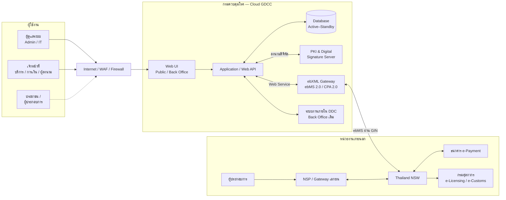
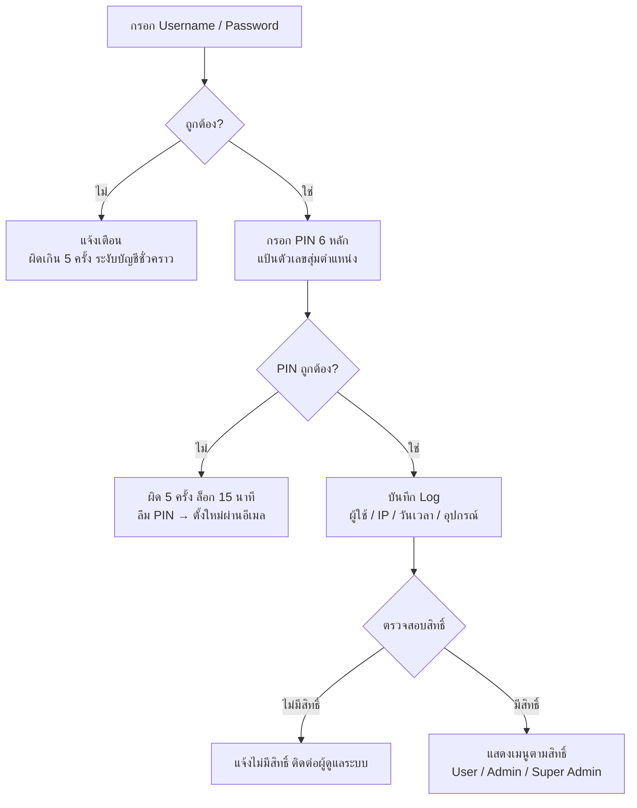
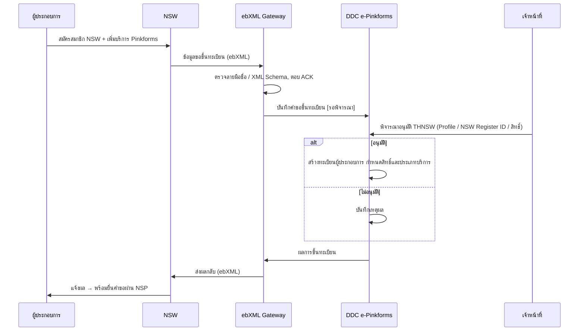
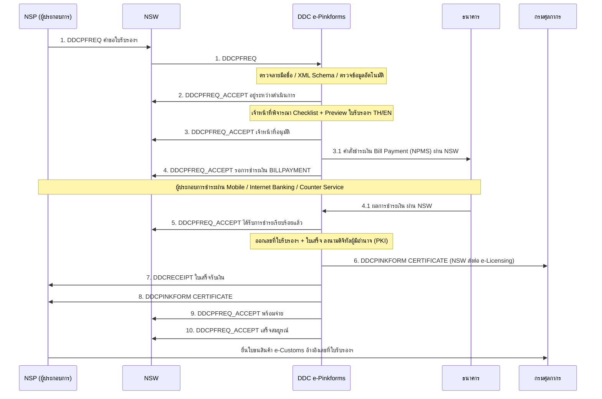

# 📘 รายละเอียดระบบ DDC e-Pinkforms

ระบบบริการใบรับรองแหล่งผลิตแหล่งกำเนิดอาหารปลอดโรค (DDC e-Pinkforms) ผ่านระบบ National Single Window (NSW)
หน่วยงาน: กองโรคติดต่อทั่วไป กรมควบคุมโรค

> แหล่งข้อมูล: `PinkForms TOR_New v.4_11-9-69.docx`, `Output/1_Flow/DDC_ePinkforms_Flow.drawio`, `Output/2_รายการหน้าจอ/รายการหน้าจอ_DDC_ePinkforms.xlsx`, `Output/4_เอกสารอธิบาย/คำอธิบายสถาปัตยกรรมระบบ_DDC_ePinkforms.docx`
> เลขข้อในวงเล็บ (เช่น TOR 4.4.2) อ้างอิงตาม TOR ฉบับ v.4 (11-9-69)

---

# 🎯 ภาพรวม

- กรมควบคุมโรคออกหนังสือรับรองแหล่งผลิตแหล่งกำเนิดสินค้าปลอดโรค (Pinkforms) ให้ผู้ประกอบการส่งออกอาหาร ผัก และผลไม้
- ระบบใหม่ต้องรองรับการทำงานผ่าน NSW เต็มรูปแบบ ตั้งแต่ยื่นคำขอ ชำระเงิน ออกใบรับรองฯ จนถึงใช้อ้างอิงในใบขนสินค้า e-Customs แบบไร้เอกสาร

## ⚠️ จุดสำคัญ

**ระบบไม่มีหน้าจอสำหรับผู้ประกอบการ** ผู้ประกอบการยื่นคำขอ ชำระเงิน และรับใบรับรองฯ ผ่านระบบของ NSP / Gateway และ NSW เท่านั้น

หน้าจอในระบบของกรมฯ มี 2 ส่วน:

| ส่วน                         | ผู้ใช้                      | เข้าสู่ระบบ                     |
| ---------------------------- | --------------------------- | ------------------------------- |
| **เว็บไซต์ประชาสัมพันธ์ (Public)** | ประชาชน / ผู้ประกอบการ / ผู้บริหาร | ไม่ต้อง                         |
| **ระบบหลังบ้าน (Back Office)**   | เจ้าหน้าที่กรมควบคุมโรค         | ต้อง (2FA: Password + PIN 6 หลัก) |

ส่วนที่ทำงานกับภายนอก (รับคำขอ, ส่งคำสั่งชำระ, ส่งใบรับรองฯ) ทำงานอัตโนมัติผ่าน ebXML Gateway และ **ไม่มีหน้าจอ**

---

# 👥 ผู้ใช้งาน

| กลุ่ม                    | หน้าที่                                                                 | บทบาทในระบบ                |
| ------------------------ | ----------------------------------------------------------------------- | -------------------------- |
| ผู้ดูแลระบบ (Admin / IT)  | จัดการผู้ใช้และสิทธิ์รายเมนู, ดูรายงานผู้ใช้, ติดตาม ebXML และใบรับรอง PKI | Admin / Super Admin        |
| เจ้าหน้าที่ฝ่ายบริการ       | ดูแลทะเบียนผู้ประกอบการ, พิจารณาคำขอใบรับรองฯ, ข้อมูลพื้นที่โรคระบาด      | User                       |
| เจ้าหน้าที่ฝ่ายการเงิน      | ติดตามการชำระเงิน, ใบเสร็จรับเงิน, กระทบยอดประจำวัน                      | User                       |
| ผู้มีอำนาจลงนาม           | ลงลายมือชื่อดิจิทัลในใบรับรองฯ และใบเสร็จรับเงิน                          | User                       |
| ประชาชน / ผู้ประกอบการ    | ดูข่าว, Dashboard, พื้นที่โรคระบาด, กฎหมาย, ทำแบบสอบถาม                   | — (ไม่ต้องเข้าสู่ระบบ)       |

ระบบภายนอก: ผู้ประกอบการ / ตัวแทนออกของ / Counter Service, NSP / Gateway เอกชน (อย่างน้อยประเภทละ 2 ราย), Thailand NSW, ธนาคาร e-Payment (อย่างน้อย 2 ธนาคาร), กรมศุลกากร (e-Licensing / e-Customs), ระบบงานภายใน DDC (Back Office เดิม)

---

# 🏗️ สถาปัตยกรรมระบบ

| ส่วนประกอบ                  | รายละเอียด                                                                                          | TOR                          |
| --------------------------- | --------------------------------------------------------------------------------------------------- | ---------------------------- |
| Web UI                      | เว็บไซต์ประชาสัมพันธ์ + ระบบหลังบ้าน, Responsive, รองรับ Windows / Mac OS                             | 4.1.1, 4.1.6 – 4.1.8         |
| Application / Web API       | รับคำขอ ตรวจอัตโนมัติ พิจารณา สร้างคำสั่งชำระ ออกใบรับรองฯ/ใบเสร็จ รายงาน ข้อมูลหลัก (16 Core / 32 GB) | 4.2, 4.4, 7.8.24 – 7.8.36    |
| Database (Active–Standby)   | RDBMS เก็บผู้ประกอบการ คำขอ ใบรับรองฯ ใบเสร็จ Log, มีเครื่องสำรอง + Backup/Restore                   | 4.1.3, 7.6, 8.1 – 8.2        |
| PKI & Digital Signature     | ลงนาม/ตรวจลายมือชื่อ, ตรวจ OCSP, แจ้งเตือนใบรับรองใกล้หมดอายุ (SMTP / SOAP 1.2), Load Balance         | 4.3.1, 4.6.2 – 4.6.3, 7.1 – 7.4 |
| ebXML Gateway               | จุดเดียวที่รับ-ส่งข้อความกับภายนอก, ตรวจ XML Schema + ลายมือชื่อ, Queue/Retry, Transaction Log, SSL   | 4.6.1, 7.7, 8.3 – 8.5        |
| ระบบงานภายใน DDC            | รับข้อมูลใบรับรองฯ และใบเสร็จจากระบบใหม่ผ่าน Web Service                                              | 7.8.38, 8.3                  |
| ระบบทดสอบ (Test)            | App-Test, Gateway-ebMS-Test, PKI Test แยกจากระบบจริง                                                 | 4.3.1 (2), 9.3 – 9.4         |
| เครือข่าย GIN               | เชื่อม ebXML Gateway กับ NSW                                                                         | 9.2, 9.8.12                  |

---

# 🔄 Flow การทำงาน

## 1. เข้าสู่ระบบ (2FA) — TOR 4.1.11

## 1.1 สร้างบัญชีและตั้ง PIN — TOR 4.1.10, 4.1.11, 4.1.15

**A. บัญชีใหม่**

1. Admin สร้างบัญชีเจ้าหน้าที่ กำหนดบทบาท / สิทธิ์ / อีเมลหน่วยงาน
2. ระบบส่งลิงก์ยืนยันอีเมล (ใช้ครั้งเดียว อายุ 24 ชม.) → สถานะ `รอยืนยันอีเมล`
3. เจ้าหน้าที่กดลิงก์ → ตั้งรหัสผ่าน → ตั้ง PIN 6 หลัก และยืนยัน PIN (หน้าจอ B-01.3)
4. ระบบเข้ารหัส PIN (Hash) เปิดใช้งานบัญชี บันทึก Audit Log → สถานะ `ใช้งาน`

**B. ลืม PIN / บัญชีถูกล็อก**

1. เจ้าหน้าที่กด "ลืม PIN" หรือ Admin สั่งรีเซ็ต PIN ที่หน้า B-16 (บันทึก Log)
2. ระบบส่งลิงก์ตั้ง PIN ใหม่ไปอีเมลที่ยืนยันแล้ว (อายุ 30 นาที)
3. ยืนยันรหัสผ่าน และตั้ง PIN ใหม่ → ปลดล็อกบัญชี + ส่งอีเมลแจ้งการเปลี่ยน PIN

**เงื่อนไข PIN**

- ตัวเลข 6 หลัก
- ห้ามเลขเรียง (123456 / 654321) หรือเลขซ้ำ (111111)
- ห้ามซ้ำกับ PIN 3 ครั้งล่าสุด
- เก็บแบบ Hash แยกจากรหัสผ่าน

## 2. ขึ้นทะเบียนผู้ใช้บริการ — TOR 4.4.1, 7.8.19 – 7.8.21

## 3. ยื่นคำขอ → ชำระเงิน → ออกใบรับรองฯ — TOR 4.2, 4.4.2 – 4.4.4, 7.8.24 – 7.8.36

**กรณีไม่ผ่าน** (ข้อมูลไม่ถูกต้อง / เจ้าหน้าที่ไม่อนุมัติ / ชำระเงินไม่สำเร็จ)

- ส่ง `DDCPFREQ_ACCEPT` พร้อมข้อความตอบกลับผ่าน NSW
- ส่ง Email แจ้งผู้ยื่นคำขอโดยอัตโนมัติ
- เก็บคำขอไว้ในระบบเป็นข้อมูลอ้างอิง (TOR 7.8.32 – 7.8.33, 7.8.36)

**ข้อกำหนดของข้อความ**

- ทุกข้อความเป็น XML Document with Digital Signature ส่งด้วย ebMS 2.0 และมี ebMS Acknowledgment ตอบกลับทุกครั้ง
- ข้อความ 3.1 / 4.1 เป็นข้อความฝั่งธนาคาร (ชื่อข้อความกำหนดร่วมกับ NSW และธนาคาร)
- ทุกข้อความบันทึก Transaction Log (Message ID, เวลา, ต้นทาง–ปลายทาง, สถานะการส่ง)

## 4. ชำระเงินและออกใบรับรองฯ (ฝั่งระบบ)

1. เจ้าหน้าที่อนุมัติคำขอ
2. สร้างคำสั่งชำระเงิน (Bill Payment) ตามมาตรฐาน NPMS และลงลายมือชื่อดิจิทัล DDC
3. ส่งคำสั่งชำระผ่าน ebXML Gateway → NSW → ธนาคาร
4. ธนาคารสร้างรายการรอชำระ (Ref.1 / Ref.2) แล้ว DDC แจ้งผู้ประกอบการ
5. รับผลการชำระเงิน (ลงนามโดยธนาคาร) ผ่าน NSW
   - **ไม่สำเร็จ** → ปฏิเสธการออกใบรับรองฯ + Email
   - **สำเร็จ** → ออกเลขที่ใบรับรองฯ และใบเสร็จรับเงิน
6. ลงลายมือชื่อดิจิทัลผู้มีอำนาจ (PKI) ในใบรับรองฯ (XML + PDF) และใบเสร็จ
7. ส่งใบรับรองฯ → NSW → e-Licensing และ NSP, ส่งใบเสร็จให้ผู้ประกอบการ
8. ส่งข้อมูลเข้าระบบงานภายใน DDC
9. ปิดคำขอ: พร้อมจ่าย → เสร็จสมบูรณ์
10. ฝ่ายการเงินดูรายงานการชำระเงินประจำวันและกระทบยอด

## 5. การพิจารณาคำขอ (กฎสำคัญ) — TOR 4.4.2

- รายการคำขอ: คำขอที่เข้าก่อนแสดงบนสุด, สูงสุด 20 รายการ/หน้า, ปรับจำนวนและการเรียงได้ (7.8.25 – 7.8.27)
- ระบบตรวจสอบคำขออัตโนมัติ ถ้าลักษณะนามสินค้าและวันที่ผลิตถูกต้อง ระบบตรวจผ่านเองได้โดยเจ้าหน้าที่ไม่ต้องกดยืนยัน
- **Checklist**: ต้องติ๊กครบทุกข้อก่อน ปุ่มอนุมัติจึงจะกดได้
- ปุ่ม **Preview** ใบรับรองฯ พร้อมใบแนบภาษาไทย / อังกฤษ ทุกครั้งก่อนอนุมัติ / ไม่อนุมัติ
- **Pop-up Confirmation** ทุกครั้งก่อนบันทึก "พิจารณาอนุมัติ" / "พิจารณาไม่อนุมัติ"
- **ยกเลิกการอนุมัติ** ได้ภายใน 15 นาทีหลังอนุมัติ ต้องระบุเหตุผล บันทึกผู้ดำเนินการ วันเวลาใน Log
- ข้อความตอบกลับ: เลือกจากรายการ, เพิ่ม/แก้ไข หรือพิมพ์ข้อความอิสระ
- ปฏิเสธได้กรณีข้อมูลไม่ตรงกับที่ลงทะเบียน และเจ้าหน้าที่แก้ไข/เพิ่มเติมได้

---

# 🚦 สถานะคำขอ — TOR 4.4.2 (8)

| ลำดับ | สถานะ                              | ผู้ดำเนินการ      | ข้อความที่ส่ง                    |
| ----- | ---------------------------------- | ----------------- | -------------------------------- |
| 1     | รับข้อมูลใบคำขอ                     | ระบบ (อัตโนมัติ)   | รับ `DDCPFREQ` (1)               |
| 2     | ตรวจสอบข้อมูลใบคำขอ                 | ระบบ / เจ้าหน้าที่  | ภายในระบบ                        |
| 3     | อยู่ระหว่างดำเนินการ                 | เจ้าหน้าที่         | `DDCPFREQ_ACCEPT` (2)            |
| 4     | เจ้าหน้าที่อนุมัติ                    | เจ้าหน้าที่         | `DDCPFREQ_ACCEPT` (3)            |
| 5     | รอการชำระเงิน BILLPAYMENT           | ระบบ + ธนาคาร     | `DDCPFREQ_ACCEPT` (4)            |
| 6     | ได้รับการชำระเรียบร้อยแล้ว            | ระบบ + ธนาคาร     | `DDCPFREQ_ACCEPT` (5)            |
| 7     | ระบบออกเลขที่ใบรับรองและใบเสร็จรับเงิน | ระบบ + PKI        | `DDCPINKFORM` / `DDCRECEIPT` (6–8) |
| 8     | แจ้งสถานะพร้อมจ่าย                   | ระบบ → NSW        | `DDCPFREQ_ACCEPT` (9)            |
| 9     | เสร็จสมบูรณ์                         | ระบบ → NSW        | `DDCPFREQ_ACCEPT` (10)           |

**สถานะสิ้นสุด (แสดงสีแดง)**: ข้อมูลไม่ถูกต้อง · เจ้าหน้าที่ไม่อนุมัติ · ชำระเงินไม่สำเร็จ (ปฏิเสธการออกใบรับรองฯ)

---

# 🖥️ รายการหน้าจอ

ทั้งหมด 31 หน้าจอ, มีตัวอย่างดีไซน์ 18 หน้าจอ (ไฟล์ภาพอยู่ที่ `Output/3_ตัวอย่างหน้าจอ/`)

## 1. เว็บไซต์ประชาสัมพันธ์ (Public)

| รหัส  | ชื่อหน้าจอ                         | องค์ประกอบหลัก                                                                                    | TOR                   | ภาพตัวอย่าง                    |
| ----- | --------------------------------- | ------------------------------------------------------------------------------------------------- | --------------------- | ----------------------------- |
| P-01  | หน้าแรกเว็บไซต์ประชาสัมพันธ์        | เมนูหลัก, ข่าว, ขั้นตอนขอใบรับรองผ่าน NSW, สถิติโดยย่อ, ตัวนับผู้เข้าชม, แถบนโยบายคุกกี้                 | 4.5.1, 4.1.13, 4.1.14 | `01_P-01_หน้าแรก.png`          |
| P-01M | หน้าแรก (มุมมองมือถือ)             | การแสดงผลแบบ Responsive                                                                           | 4.1.1, 4.1.6          | `02_P-01M_หน้าแรก-มือถือ.png`  |
| P-02  | Dashboard สถิติใบรับรองฯ           | ใบรับรองฯ ตามประเทศปลายทาง, สินค้าส่งออกสูงสุด, จำนวนคำขอ/ใบรับรองฯ/ผู้ประกอบการ, เลือกรายเดือน/รายปี   | 4.5.2                 | `03_P-02_Dashboard.png`        |
| P-03  | ตรวจสอบข้อมูลพื้นที่โรคระบาด        | ค้นหาจังหวัด/อำเภอ/ตำบล, ตารางพื้นที่ยังไม่ปลอดโรค, กราฟรายเดือน/รายปี ย้อนหลัง 5 ปี                   | 4.5.1, 4.5.2          | `04_P-03_พื้นที่โรคระบาด.png`   |
| P-04  | ข่าวประชาสัมพันธ์                  | รายการข่าว, ค้นหา, หน้ารายละเอียด                                                                  | 4.5.1                 | —                             |
| P-05  | กฎหมายและคู่มือที่เกี่ยวข้อง         | รายการกฎหมาย ประกาศ คู่มือ ดาวน์โหลด PDF                                                           | 4.5.1                 | —                             |
| P-06  | แบบสอบถามความพึงพอใจ              | แบบฟอร์มประเมินความพึงพอใจ                                                                        | 4.5.1                 | —                             |
| P-07  | นโยบายคุกกี้ / ความเป็นส่วนตัว       | คำอธิบายคุกกี้ การลบและปฏิเสธคุกกี้, PDPA                                                          | 4.1.14, 6.1           | —                             |

## 2. ระบบหลังบ้าน (Back Office)

| รหัส   | กลุ่ม                       | ชื่อหน้าจอ                            | ผู้ใช้                | องค์ประกอบหลัก                                                                                     | ภาพตัวอย่าง                                  |
| ------ | -------------------------- | ------------------------------------ | -------------------- | -------------------------------------------------------------------------------------------------- | ------------------------------------------- |
| B-01   | เข้าสู่ระบบ / ภาพรวม         | เข้าสู่ระบบ ขั้นที่ 1 (Username/Password) | เจ้าหน้าที่ทุกกลุ่ม     | ชื่อผู้ใช้ รหัสผ่าน, จดจำชื่อผู้ใช้, ลืมรหัสผ่าน                                                      | `05a_B-01_เข้าสู่ระบบ-ขั้นที่1-Username.png`    |
| B-01.2 | เข้าสู่ระบบ / ภาพรวม         | เข้าสู่ระบบ ขั้นที่ 2 (PIN 6 หลัก)      | เจ้าหน้าที่ทุกกลุ่ม     | แป้นตัวเลขสุ่มตำแหน่ง, นับครั้งที่ผิด (ล็อก 15 นาทีเมื่อผิด 5 ครั้ง), ลืม PIN                          | `05b_B-01.2_เข้าสู่ระบบ-ขั้นที่2-PIN.png`      |
| B-01.3 | เข้าสู่ระบบ / ภาพรวม         | ยืนยันอีเมลและตั้ง PIN                | เจ้าหน้าที่ (บัญชีใหม่) | ลิงก์ใช้ครั้งเดียว 24 ชม., ตั้งรหัสผ่าน, ตั้ง/ยืนยัน PIN, ตรวจเงื่อนไข PIN                              | `05c_B-01.3_ยืนยันอีเมล-ตั้ง-PIN.png`         |
| B-01.4 | เข้าสู่ระบบ / ภาพรวม         | ลืม PIN / ตั้ง PIN ใหม่                | เจ้าหน้าที่            | ขอลิงก์ทางอีเมล, Admin รีเซ็ต PIN (บันทึก Log), ปลดล็อกบัญชี                                          | —                                           |
| B-02   | เข้าสู่ระบบ / ภาพรวม         | หน้าหลักเจ้าหน้าที่                     | เจ้าหน้าที่ทุกกลุ่ม     | จำนวนคำขอตามสถานะ, งานรอพิจารณา, การชำระเงินวันนี้, สถานะเชื่อมต่อ NSW/ebXML, PKI ใกล้หมดอายุ             | `06_B-02_หน้าหลักเจ้าหน้าที่.png`              |
| B-03   | ทะเบียนผู้ประกอบการ          | ข้อมูลผู้ประกอบการ                     | ฝ่ายบริการ            | ค้นหาเลขผู้เสียภาษี/สาขา/ชื่อบริษัท (ไทย/Eng)/สิทธิ์/ประเภทบริการ, เพิ่ม/ลบ                              | `07_B-03_ข้อมูลผู้ประกอบการ.png`              |
| B-04   | ทะเบียนผู้ประกอบการ          | พิจารณาอนุมัติ THNSW                   | ฝ่ายบริการ            | ค้นหา Profile/NSW Register ID/สิทธิ์, อนุมัติ/ไม่อนุมัติการขึ้นทะเบียน                                  | —                                           |
| B-05   | รับและพิจารณาคำขอ           | รายการคำขอใบรับรองฯ                   | ฝ่ายบริการ            | Reference No., วันที่ส่ง, Invoice No., บริษัท, Brandname, ประเทศ, จำนวนสินค้า, สถานะ, View; 20 รายการ/หน้า | `08_B-05_รายการคำขอ.png`                    |
| B-06   | รับและพิจารณาคำขอ           | รายละเอียดคำขอและพิจารณา (Checklist)   | ฝ่ายบริการ            | คำขอฉบับเต็ม, ผลตรวจอัตโนมัติ, Checklist, ข้อความตอบกลับ, ปุ่มอนุมัติ/ไม่อนุมัติ                         | `09_B-06_พิจารณาคำขอ.png`                   |
| B-07   | รับและพิจารณาคำขอ           | Preview ใบรับรองฯ TH/EN + Pop-up ยืนยัน | ฝ่ายบริการ            | ใบรับรองพร้อมใบแนบไทย/อังกฤษ, หน้าต่างยืนยันก่อนบันทึกผล                                              | `10_B-07_Preview-ยืนยัน.png`                |
| B-08   | รับและพิจารณาคำขอ           | ยกเลิกการอนุมัติ (15 นาที)              | ฝ่ายบริการ            | นับถอยหลัง 15 นาที, ระบุเหตุผล, บันทึก Log                                                          | —                                           |
| B-09   | รับและพิจารณาคำขอ           | ติดตามสถานะคำขอ                       | เจ้าหน้าที่ทุกกลุ่ม     | ค้นหาคำขอ, ข้อมูลผู้ยื่น (ตัวแทนออกของ/Counter Service), Timeline สถานะพร้อมวันเวลา                     | `11_B-09_ติดตามสถานะ.png`                   |
| B-10   | ใบรับรองและการชำระเงิน      | ข้อมูลใบรับรองฯ                        | ฝ่ายบริการ            | รายการใบรับรองที่ออกแล้ว, ค้นหา, ดู PDF                                                              | —                                           |
| B-11   | ใบรับรองและการชำระเงิน      | ติดตามการชำระเงินค่าบริการ              | ฝ่ายการเงิน           | วันที่ส่ง, เลขที่อ้างอิง, บริษัท, Ref.1/Ref.2, รหัสธนาคาร, จำนวนเงิน, สถานะ, ยอดรวมประจำวัน             | `12_B-11_ติดตามการชำระเงิน.png`              |
| B-12   | ใบรับรองและการชำระเงิน      | ใบเสร็จรับเงิน                          | ฝ่ายการเงิน           | รายการใบเสร็จ, ผู้มีอำนาจลงนาม, ดู PDF                                                               | —                                           |
| B-13   | รายงาน                     | รายงานสรุป / ดาวน์โหลด                 | เจ้าหน้าที่ / ผู้บริหาร  | ผู้ประกอบการ, ค่าบริการ, ใบเสร็จ, ใบรับรองตามประเทศ, ส่งออก Excel/CSV                                 | —                                           |
| B-14   | ข้อมูลหลัก                  | ข้อมูลพื้นที่โรคระบาด                   | ฝ่ายบริการ            | ค้นหา/เพิ่ม/ลบ, วันที่เกิดโรค, คำนวณวันปลอดโรคอัตโนมัติ (+21 วัน), ผู้บันทึกและวันเวลา                    | `13_B-14_ข้อมูลพื้นที่โรคระบาด.png`            |
| B-15   | ข้อมูลหลัก                  | ข้อมูลหลักอื่น ๆ                        | ผู้ดูแลระบบ           | หน่วยงาน DDC, บัญชีธนาคาร, ผู้มีอำนาจลงนาม, พิกัดศุลกากร, ท่าขนถ่าย, หีบห่อ, สกุลเงิน, ข้อความตอบกลับ, ตำบล/อำเภอ/จังหวัด, ประเทศ | — |
| B-16   | ผู้ดูแลระบบ / การเชื่อมโยง    | จัดการผู้ใช้งานและสิทธิ์                 | Admin / Super Admin  | รายชื่อผู้ใช้, บทบาท, สถานะ PIN, รีเซ็ต PIN, สิทธิ์รายเมนู, ประวัติการจัดการผู้ใช้                       | `14_B-16_จัดการผู้ใช้งาน.png`                 |
| B-17   | ผู้ดูแลระบบ / การเชื่อมโยง    | ติดตามการรับ-ส่งข้อความ ebXML          | IT                   | Message ID, ประเภทเอกสาร, ต้นทาง–ปลายทาง, เวลา, สถานะ, Retry, ดู XML                                 | `15_B-17_ติดตาม-ebXML.png`                  |
| B-18   | ผู้ดูแลระบบ / การเชื่อมโยง    | จัดการใบรับรองอิเล็กทรอนิกส์ (PKI)      | IT                   | รายการ Certificate, ผล OCSP, วันหมดอายุ, ตั้งค่าแจ้งเตือน วัน/สัปดาห์/เดือน                             | `16_B-18_จัดการ-PKI.png`                    |
| B-19   | ผู้ดูแลระบบ / การเชื่อมโยง    | ประวัติการใช้งาน (Audit Log)            | Admin / Super Admin  | ผู้ใช้, เครื่อง, วันเวลา, ข้อมูลก่อน-หลังแก้ไข, เก็บไม่น้อยกว่า 90 วัน                                  | —                                           |
| B-20   | ผู้ดูแลระบบ / การเชื่อมโยง    | รายงานผู้เข้าชมเว็บไซต์                 | Admin                | ผู้เข้าชมรายวัน/รายเดือน, หน้าที่เข้าชมมากที่สุด                                                       | —                                           |

## เมนูหลังบ้าน (ตามตัวอย่างหน้าจอ B-02)

| กลุ่มเมนู    | เมนู                                                          |
| ----------- | ------------------------------------------------------------- |
| ภาพรวม      | หน้าหลัก                                                       |
| งานบริการ   | ทะเบียนผู้ประกอบการ, พิจารณาอนุมัติ THNSW, คำขอใบรับรองฯ, ติดตามสถานะคำขอ, ข้อมูลใบรับรองฯ |
| การเงิน      | ติดตามการชำระเงิน, ใบเสร็จรับเงิน                                |
| ข้อมูลหลัก   | พื้นที่โรคระบาด, ข้อมูลหลักอื่น ๆ                                 |
| รายงาน      | รายงานสรุป                                                     |
| ผู้ดูแลระบบ  | ผู้ใช้งานและสิทธิ์, ติดตาม ebXML, ใบรับรอง PKI, Audit Log          |

---

# 🔍 ข้อมูลที่ใช้ค้นหาในแต่ละหน้า

| หน้าจอ               | ค้นหาจาก                                                                                           | TOR          |
| -------------------- | -------------------------------------------------------------------------------------------------- | ------------ |
| ข้อมูลผู้ประกอบการ    | เลขประจำตัวผู้เสียภาษี, สาขา, ชื่อบริษัท (ไทย/Eng), สิทธิ์การเข้าใช้งาน, ประเภทบริการ                       | 4.4.1 (1)    |
| พิจารณาอนุมัติ THNSW  | Profile, NSW Register ID, สิทธิ์การเข้าใช้งาน                                                         | 4.4.1 (2)    |
| คำขอ / ติดตามสถานะ    | เลขผู้เสียภาษี, ชื่อบริษัท (ไทย/Eng), Reference No., เลขที่ใบรับรอง, วันที่ส่งข้อมูล, Invoice No., เลขที่ใบสีชมพู, เลข PF-ID, จำนวนต่อหน้า | 4.4.2 (9), 7.8.28 |
| ข้อมูลใบรับรองฯ       | เลขผู้เสียภาษี, ชื่อบริษัท, Reference No., เลขที่ใบรับรอง, วันที่ส่งข้อมูล, Invoice No.                     | 4.4.3 (2)    |
| การชำระเงิน / ใบเสร็จ  | เลขผู้เสียภาษี, ชื่อบริษัท, เลขที่อ้างอิง, เลขที่ใบคำขอ, Ref.1, สถานะ, รหัสธนาคาร, วันที่ส่งข้อมูล            | 4.4.4 (3)    |
| พื้นที่โรคระบาด        | จังหวัด, อำเภอ, ตำบล (ชื่อ/รหัส), วันที่เกิดโรคระบาด                                                    | 4.4.8 (6)    |

---

# 📊 Dashboard (Public) — TOR 4.5.2

- ใบรับรองฯ ตามประเทศผู้รับสินค้าปลายทาง (ชื่อประเทศ + จำนวน เรียงลำดับ)
- สินค้าที่ส่งออกมากที่สุด
- จำนวนการยื่นคำขอ
- จำนวนใบรับรองฯ ที่ออกให้ผู้ประกอบการ
- จำนวนผู้ประกอบการ (ที่ลงทะเบียน + ที่ร่วมผูกสัมพันธ์)
- พื้นที่โรคระบาดทั้งหมด เป็นกราฟเส้นและ/หรือแท่ง รายเดือน รายปี ย้อนหลัง 5 ปี

---

# 📋 ฟิลด์ของหน้าจอหลัก

| หน้าจอ                       | ฟิลด์ / องค์ประกอบ                                                                                                                                                         | TOR             |
| ---------------------------- | ------------------------------------------------------------------------------------------------------------------------------------------------------------------------ | --------------- |
| B-05 รายการคำขอ               | Reference No., วันที่ส่งข้อมูล, Invoice No., ชื่อบริษัท, Brandname, ประเทศผู้รับสินค้า, จำนวนรายการสินค้า, สถานะ, ปุ่ม View (คำขอฉบับเต็ม)                                         | 4.4.2 (1)       |
| B-06 รายละเอียดคำขอ            | คำขอฉบับเต็ม + **เอกสารประกอบ**, ผลตรวจอัตโนมัติ (ถูกต้อง/ไม่ถูกต้อง, ครบถ้วน/ไม่ครบถ้วน), Checklist, แก้ไข/เพิ่มเติมข้อมูล, ข้อความตอบกลับ                                         | 4.4.2, 7.8.30 – 7.8.31 |
| B-07 Preview                 | ใบรับรองฯ + ใบแนบภาษาไทย/อังกฤษ แสดงเป็นแบบฟอร์มตามมาตรฐาน XSL 1.1                                                                                                          | 4.4.2 (7), 7.4.2 |
| B-09 ติดตามสถานะ (รายการ)       | Reference No., วันที่ส่งข้อมูล, Invoice No., ชื่อบริษัท, รหัสธนาคาร, เลขที่ใบรับรอง, Brandname, ประเทศผู้รับสินค้า, จำนวนรายการสินค้า, สถานะ, View                                | 4.4.2 (8)       |
| B-09 ติดตามสถานะ (View)        | Reference No., ประเภทกิจการ, เลขผู้เสียภาษี, สาขา, ชื่อบริษัท (ถ้าใช้ Profile ตัวแทนออกของ/Counter Service ให้แสดงข้อมูลของตัวแทน), ตาราง สถานะ / รายละเอียด / วันที่และเวลา, ผลการส่งข้อมูลไปกรมศุลกากร | 4.4.2 (8), 7.8.36 |
| B-10 ข้อมูลใบรับรองฯ            | Reference No., วันที่ส่งข้อมูล, Invoice No., ชื่อบริษัท, เลขที่ใบรับรอง, ประเทศผู้รับสินค้า, จำนวนรายการสินค้า, View (PDF)                                                       | 4.4.3 (1)       |
| B-11 ติดตามการชำระเงิน          | วันที่ส่งข้อมูล, เลขที่อ้างอิง, ชื่อบริษัท, เลขที่ใบคำขอ, Ref.1 (เลขที่ใบกำกับสินค้า), Ref.2 (ลำดับรายการ), รหัสธนาคาร, จำนวนเงิน (บาท), สถานะ, View                             | 4.4.4 (1)       |
| B-12 ใบเสร็จรับเงิน              | วันที่ออกใบเสร็จ, เลขที่อ้างอิง, ชื่อบริษัท, เลขที่ใบคำขอ, Ref.1, Ref.2, รหัสธนาคาร, เลขที่ใบเสร็จ, ผู้มีอำนาจลงนาม, จำนวนเงิน (บาท), View (PDF)                                     | 4.4.4 (2)       |
| B-13 รายงานสรุป                | รายงานผู้ประกอบการ, ค่าชำระบริการ, ใบเสร็จรับเงิน, ใบรับรองฯ ตามประเทศผู้รับสินค้า ฯลฯ — เพิ่ม/ลบ/แก้ไขรายงานได้ และดาวน์โหลดเป็นไฟล์ (TOR เขียน ".exe, csv" น่าจะหมายถึง Excel / CSV) | 4.4.6           |

---

# 🗂️ ข้อมูลหลัก (Master Data) — TOR 4.4.8

ทุกรายการ View / Edit และเพิ่ม / ลบได้

| #    | ข้อมูล                   | ฟิลด์                                                                                                 | ค้นหาจาก                                   |
| ---- | ----------------------- | ----------------------------------------------------------------------------------------------------- | ------------------------------------------ |
| 1    | หน่วยงาน DDC             | รหัสหน่วยงาน, เลขผู้เสียภาษี, ชื่อหน่วยงาน (ไทย/อังกฤษ), ที่อยู่, CA Alias, Profile, NSW Register ID, วันเวลาบันทึกล่าสุด | —                                          |
| 2    | บัญชีธนาคาร DDC          | ลำดับ, เลขที่บัญชี, ชื่อบัญชี, ประเภทการชำระ (เช่น Cross Bank Bill Payment)                                  | —                                          |
| 3    | ผู้มีอำนาจลงนามใบรับรองฯ   | ลำดับ, เลขประจำตัว, ชื่อ–นามสกุล, ตำแหน่ง, ประเภทเอกสาร, ชื่อไฟล์, สถานะ (ใช้/ไม่ได้ใช้)                         | —                                          |
| 4    | ผู้มีอำนาจลงนามใบเสร็จ     | เหมือนข้อ 3                                                                                            | —                                          |
| 5    | รหัสพิกัดศุลกากร          | ลำดับ, พิกัดศุลกากร, รหัสสถิติ, คำอธิบาย                                                                  | —                                          |
| 6    | พื้นที่โรคระบาด (B-14)     | รหัส/ชื่อ จังหวัด อำเภอ ตำบล, คำอธิบาย (ไทย) จากกองระบาดวิทยา, วันที่เกิดโรค, วันที่ปลอดโรค (= วันเกิดโรค + 21 วัน อัตโนมัติ), ผู้บันทึก, วันเวลา | ชื่อ/รหัส จังหวัด อำเภอ ตำบล, วันที่เกิดโรค |
| 7    | รหัสท่าขนถ่าย             | ลำดับ, รหัสท่า, ชื่อท่า, รหัสประเทศ                                                                      | รหัสท่า, ชื่อท่า                             |
| 8    | รหัสหน่วยหีบห่อ            | ลำดับ, รหัส, ชื่อหน่วยหีบห่อ                                                                             | รหัส, ชื่อ                                  |
| 9    | รหัสสกุลเงินตรา           | ลำดับ, รหัสสกุลเงิน, ชื่อสกุลเงิน                                                                         | รหัส, ชื่อ                                  |
| 10   | รหัสข้อความตอบกลับ        | ลำดับ, รหัส, ข้อความตอบกลับ, คำอธิบาย — **Admin เท่านั้นที่เพิ่ม/ลบ**                                       | รหัส, ข้อความ                               |
| 11   | รหัสตำบล                 | ลำดับ, รหัสตำบล, รหัสอำเภอ, รหัสจังหวัด                                                                   | —                                          |
| 12   | รหัสอำเภอ                | ชื่อตำบล, ชื่ออำเภอ, ชื่อจังหวัด (ไทย/อังกฤษ)                                                               | —                                          |
| 13   | รหัสจังหวัด               | ลำดับ, ชื่อจังหวัด (ไทย/อังกฤษ)                                                                           | —                                          |
| 14   | รหัสประเทศ               | ลำดับ, รหัสประเทศ, ชื่อประเทศ                                                                            | รหัส, ชื่อประเทศ                            |

---

# 🔗 การเชื่อมโยงข้อมูล — TOR 4.4.5, 4.6.1, 7.8.1 – 7.8.18, 7.8.37 – 7.8.38, 8.3 – 8.6

**ebXML (ช่องทางหลัก)**

- ebMS 2.0 + CPA 2.0 ตามที่ NSW และกรมศุลกากรกำหนด **ตั้งค่า / ปรับเปลี่ยน CPA ได้** และรองรับการปรับเวอร์ชันในอนาคต
- Queue / Retry เมื่อรับ-ส่งล้มเหลว
- รับ-ส่ง จัดเก็บ และตรวจสอบ XML ของ: คำขอ, คำสั่งชำระเงิน, ผลการชำระเงิน, ใบรับรองฯ, ใบเสร็จรับเงิน
- XML Schema Validation และ XML Digital Signature ทุกข้อความ
- Transaction Log: Message ID, เวลา, ต้นทาง–ปลายทาง, สถานะการส่ง

**API (ทางเลือก)**

- REST (JSON) หรือ SOAP (XML) ตามมาตรฐาน NSW / กรมศุลกากร
- มี API Specification, Data Dictionary, Sample Request/Response
- ยืนยันตัวตนด้วย API Key / OAuth 2.0 ผ่าน HTTPS (TLS)
- Log การเรียก API: Endpoint, ผู้เรียก, วันเวลา, สถานะตอบกลับ, Error Code

**เอกสารอิเล็กทรอนิกส์**

- คำขอและใบรับรองฯ เป็น XML ตาม XML Schema ของกรมฯ สอดคล้อง WCO Data Model และ UN/CCL (7.8.16)
- คำขอต้องลงลายมือชื่อดิจิทัลโดยผู้ยื่น (7.8.17), ใบรับรองฯ ลงลายมือชื่อดิจิทัลโดยผู้มีอำนาจของกรมฯ (7.8.18)
- ข้อความชำระเงินตามมาตรฐาน NPMS

**Web Service ภายใน**

- DDC e-Pinkforms ↔ ebMS Gateway, PKI Management Server: คำขอ, คำสั่งชำระเงิน, ใบรับรองฯ, ใบเสร็จ (7.8.37)
- DDC e-Pinkforms ↔ ระบบงานภายใน (Back Office เดิม): ใบรับรองฯ, ใบเสร็จรับเงิน และบันทึกผลการรับส่งลงฐานข้อมูล Back Office (7.8.38, 8.3)
- ทั้งสองส่วนต้องมี **หน้าจอให้ผู้ดูแลตรวจสอบการทำงานและความถูกต้องของข้อมูล**
- ควบคุมแบบรวมศูนย์: กำหนดค่า ดูแล และ Monitor ได้ (8.6)

**ระบบภายนอกที่ต้องเชื่อม (ผ่าน NSW เท่านั้น)**

e-Licensing, e-Customs, e-Payment (≥ 2 ธนาคาร), Gateway (≥ 2 ราย), NSP (≥ 2 ราย), ผู้ประกอบการ/ตัวแทนออกของ/Counter Service (≥ 1 ราย)

---

# 🔏 PKI & Digital Signature — TOR 4.6.2 – 4.6.3, 7.1 – 7.4

| ส่วน                                   | ความสามารถ                                                                                                     |
| -------------------------------------- | ------------------------------------------------------------------------------------------------------------- |
| Certificate Management Server (7.1)    | เก็บ Public Key Certificate จาก CA / เจ้าของข้อมูล, รายงานสถานภาพ, แจกจ่ายให้ Certificate Agent เมื่อ Partner ร้องขอ, ตรวจสถานะด้วย OCSP |
| แจ้งเตือนใบรับรอง (7.1.5 – 7.1.6)        | แจ้งอัตโนมัติ (SMTP / SOAP 1.2) เมื่อ **ใกล้หมดอายุ / หมดอายุ / ถูกยกเลิก / ระงับชั่วคราว**, ตั้งช่วงเวลาแจ้ง Admin ระดับ วัน / สัปดาห์ / เดือน |
| Certificate Agent (7.2)                | ซิงก์สถานภาพจาก Server อัตโนมัติ, ตั้งความถี่ตรวจระดับ วินาที / นาที / ชั่วโมง, แจ้งเตือนเหมือน 7.1.5                    |
| Signature Management Server (7.3)      | จัดการการลงลายมือชื่อ, ผูก Agent ตามบทบาท **Signer** (ผู้ลงนาม) / **Issuer** (ผู้ส่งเรื่องรอลงนาม)                     |
| Signature Agent (7.4)                  | รับ-ส่งกับ Server ด้วย SOAP 1.2 / ebMS 2.0, แสดงเอกสารเป็นแบบฟอร์มด้วย XSL 1.1, ลง/ตรวจลายมือชื่อตาม W3C XML Signature, เข้า/ถอดรหัสตาม W3C XML Encryption |
| Digital Certificate สำหรับ (4.6.3)      | ผู้ลงทะเบียนของกรมฯ (Registration/Provider), เจ้าหน้าที่ฝ่ายบริการ / การเงิน / IT, ผู้มีอำนาจลงนาม (อธิบดี / ผอ.กอง / ผู้รับมอบอำนาจ) |
| ระบบ                                   | Production 1 ระบบ + Test 1 ระบบ, Redundancy / Load Balance                                                     |

---

# ➕ Function ตาม TOR ที่ยังไม่มีในรายการหน้าจอ

จากการเทียบกับ TOR พบ function ที่ TOR กำหนดแต่ยังไม่มีหน้าจอรองรับใน `รายการหน้าจอ_DDC_ePinkforms.xlsx` เสนอเพิ่มดังนี้ (รหัสหน้าจอเป็นรหัสที่เสนอใหม่)

| รหัส (เสนอ) | ชื่อหน้าจอ                                   | ผู้ใช้           | องค์ประกอบหลัก                                                                         | TOR                 |
| ---------- | ------------------------------------------- | --------------- | -------------------------------------------------------------------------------------- | ------------------- |
| B-21       | จัดการเนื้อหาเว็บไซต์ (ข่าว / กฎหมาย / คู่มือ)     | Admin           | เพิ่ม/ลบ/แก้ไข ข่าวประชาสัมพันธ์ เอกสารกฎหมาย คู่มือ ที่แสดงบน P-04, P-05                       | 4.5 ("สามารถ เพิ่ม ลบ แก้ไข ได้"), 4.5.1 |
| B-22       | จัดการแบบสอบถามและผลแบบสอบถาม               | Admin           | สร้าง/แก้ไขแบบสอบถาม (P-06), ดูผลและส่งออก                                                | 4.5, 4.5.1          |
| B-23       | ตั้งค่า CPA / การเชื่อมต่อ ebMS               | IT              | รายการ CPA ต่อคู่ Partner, แก้ไขค่า, เวอร์ชัน, ตั้งค่า Queue/Retry                              | 4.6.1 (1), 8.6      |
| B-24       | ติดตามการเชื่อมโยง API                      | IT              | Log การเรียก API (Endpoint, ผู้เรียก, เวลา, สถานะ, Error Code), จัดการ API Key / Client       | 4.6.1 (API)         |
| B-25       | ติดตามการส่งข้อมูลระบบงานภายใน DDC           | IT / Admin      | รายการใบรับรองฯ/ใบเสร็จที่ส่งเข้า Back Office เดิม, สถานะ, ส่งซ้ำ, ตรวจความถูกต้องของข้อมูล         | 7.8.38, 8.3         |

**ส่วนที่ควรระบุเพิ่มในหน้าจอเดิม**

- **B-02 / B-09**: แสดงผลการส่งใบรับรองฯ ไปกรมศุลกากร (e-Licensing) ให้ผู้ใช้ทราบ (7.8.36)
- **B-06**: แสดงเอกสารประกอบคำขอ (7.8.30)
- **B-05 / B-09**: ค้นหาด้วยเลขที่ใบสีชมพู และเลข PF-ID (7.8.28)
- **B-17**: ตรวจสอบความถูกต้องของข้อมูลระหว่าง DDC e-Pinkforms กับ ebMS Gateway / PKI (7.8.37 •2)
- **B-18**: แยกตั้งค่าความถี่ตรวจของ Agent (วินาที/นาที/ชั่วโมง) และผูกบทบาท Signer / Issuer (7.2.2, 7.3.2)
- **ระบบ Email**: แจ้งผู้ยื่นอัตโนมัติเมื่อคำขอถูกปฏิเสธ หรือชำระเงินไม่สำเร็จ (7.8.32, 7.8.36)

---

# ✅ ตารางตรวจสอบความครบถ้วน (Functional Requirement)

อ้างอิง 123 ข้อใน `Checklist_TOR_DDC_ePinkforms.xlsx` แท็บ Functional
✅ = มีครบในเอกสารนี้ · ➕ = เสนอเพิ่มในหัวข้อ "Function ตาม TOR ที่ยังไม่มีในรายการหน้าจอ"

| ข้อ TOR                    | Function                                          | ครอบคลุมโดย                                     | สถานะ |
| -------------------------- | ------------------------------------------------- | ----------------------------------------------- | ----- |
| 4.1.10, 4.1.12             | สิทธิ์ผู้ใช้ / รายงานผู้ใช้และประวัติการจัดการ          | B-16, Flow 1.1                                  | ✅    |
| 4.1.13, 4.1.14             | ตัวนับผู้เข้าชม + รายงาน, นโยบายคุกกี้                | P-01, P-07, B-20                                | ✅    |
| 4.2.1 – 4.2.3              | ยื่นคำขอ, ชำระเงิน, พิธีการศุลกากรไร้เอกสาร            | Flow 3, 4                                       | ✅    |
| 4.4.1 (1)(2)               | ทะเบียนผู้ประกอบการ, อนุมัติ THNSW                   | B-03, B-04, Flow 2                              | ✅    |
| 4.4.2 (1) – (9)            | รับและพิจารณาคำขอ, ยกเลิกอนุมัติ, ติดตามสถานะ, ค้นหา   | B-05 – B-09, Flow 5, ฟิลด์ของหน้าจอหลัก           | ✅    |
| 4.4.3 (1)(2)               | ข้อมูลใบรับรองฯ + ค้นหา                             | B-10                                            | ✅    |
| 4.4.4 (1) – (3)            | ติดตามการชำระเงิน, ใบเสร็จ, ค้นหา                     | B-11, B-12                                      | ✅    |
| 4.4.5                      | Web Service กับ ebMS GW / PKI / Back Office        | การเชื่อมโยงข้อมูล                                 | ✅    |
| 4.4.6                      | รายงานสรุป เพิ่ม/ลบ/แก้ไข/ดาวน์โหลด                   | B-13                                            | ✅    |
| 4.4.7                      | สิทธิ์ user / admin / super admin                   | B-16                                            | ✅    |
| 4.4.8 (1) – (14)           | ข้อมูลหลัก 14 รายการ                                | B-14, B-15, ข้อมูลหลัก                            | ✅    |
| 4.5 (เพิ่ม/ลบ/แก้ไขได้)       | จัดการเนื้อหาเว็บไซต์ประชาสัมพันธ์                     | B-21, B-22                                      | ➕    |
| 4.5.1, 4.5.2 (6 รายการ)     | เมนูเว็บไซต์ + Dashboard                            | P-01 – P-06, Dashboard                          | ✅    |
| 4.6.1 (1)                  | ebMS 2.0 / CPA 2.0, ปรับค่า CPA, Queue/Retry        | B-17, B-23                                      | ➕    |
| 4.6.1 (2)                  | รับ-ส่ง/จัดเก็บ/ตรวจ XML + Transaction Log           | B-17                                            | ✅    |
| 4.6.1 (API)                | REST/SOAP, API Key/OAuth 2.0, Log API              | B-24                                            | ➕    |
| 4.6.2, 4.6.3               | PKI, Digital Certificate ทุกกลุ่มผู้ใช้               | B-18, PKI & Digital Signature                    | ✅    |
| 7.1 – 7.4                  | Certificate / Signature Server และ Agent           | B-18, PKI & Digital Signature                    | ✅    |
| 7.8.1 – 7.8.3, 7.8.5       | ebMS/API ผ่าน NSW, XML/XSD, Digital Signature       | การเชื่อมโยงข้อมูล, Flow 3                         | ✅    |
| 7.8.10 – 7.8.15            | เชื่อมผู้ประกอบการ, NSP, Gateway, ธนาคาร, ศุลกากร     | สถาปัตยกรรม, การเชื่อมโยงข้อมูล                     | ✅    |
| 7.8.16 – 7.8.18            | XML ตาม WCO/UN-CCL, คำขอ/ใบรับรองลงนามดิจิทัล        | การเชื่อมโยงข้อมูล                                 | ✅    |
| 7.8.19 – 7.8.23            | ทะเบียนผู้ประกอบการ / ผู้ใช้งาน                       | B-03, B-04, B-16, Flow 2                        | ✅    |
| 7.8.24 – 7.8.31            | รับ/พิจารณาคำขอ, 20 รายการ/หน้า, ค้นหา, สถานะ, ตรวจอัตโนมัติ | B-05 – B-09, Flow 5                        | ✅    |
| 7.8.32 – 7.8.33            | ปฏิเสธ + Email อัตโนมัติ, เก็บคำขอที่ถูกปฏิเสธ           | Flow 3                                          | ✅    |
| 7.8.34 – 7.8.36            | คำสั่งชำระ, ผลชำระ, ออกใบรับรอง, ส่งศุลกากร/ผู้ประกอบการ | Flow 3, 4                                       | ✅    |
| 7.8.37 •1                  | Web Service กับ ebMS GW / PKI                       | การเชื่อมโยงข้อมูล                                 | ✅    |
| 7.8.37 •2                  | หน้าจอตรวจการทำงาน/ความถูกต้อง (GW / PKI)            | B-17, B-18                                      | ✅    |
| 7.8.38 •1, •2, 8.3         | Web Service + หน้าจอตรวจ ระบบงานภายใน DDC            | B-25                                            | ➕    |
| 8.4, 8.5                   | XML Schema Validation, XML Digital Signature        | Flow 3, การเชื่อมโยงข้อมูล                          | ✅    |
| 8.6                        | ควบคุมรวมศูนย์ กำหนดค่า / ดูแล / Monitor               | B-17, B-18, B-23                                | ➕    |

---

# 🔐 ความปลอดภัยและ Log

- 2FA: Username / Password + PIN 6 หลัก (TOR 4.1.11)
- สิทธิ์ผู้ใช้ 3 ระดับ User / Admin / Super Admin กำหนดสิทธิ์รายเมนูผ่านเบราว์เซอร์ (TOR 4.1.10, 4.4.7)
- Transaction Log: ใครแก้ไข จากเครื่องใด เมื่อไร ข้อมูลเดิมคืออะไร เก็บไม่น้อยกว่า 90 วัน (สูงสุด 2 ปีเมื่อมีคำสั่ง) (TOR 4.1.15)
- ตัวนับผู้เข้าชม และนโยบายคุกกี้ (TOR 4.1.13, 4.1.14)
- PDPA, OWASP Top 10, Penetration Test / VA Scan ก่อนขึ้นระบบ Major Version (TOR 6.1 – 6.5)
- เกณฑ์ CTAM: Backup, Antivirus, Access Control, PAM, BCP/DRP, OS Patching, 2FA, Log Management (TOR 6.7)

---

# 🎨 แนวทางการออกแบบ (จาก Figma)

อ้างอิง: [Figma — DDC e-Pinkforms](https://www.figma.com/design/O1QKAG1dNDQ7DROItvmJhU/DDC-e-Pinkforms) · ค่า Token ทั้งหมดอยู่ใน [flamework.md](flamework.md)

| หัวข้อ        | ค่า                                                                                                |
| ------------ | -------------------------------------------------------------------------------------------------- |
| แนวคิด       | ระบบราชการด้านสาธารณสุข น่าเชื่อถือ สะอาด อ่านง่าย ใช้ Teal เป็นหลัก Pink เป็นสีเน้น                     |
| Primary      | `#0A6578` Teal — ปุ่มหลัก ลิงก์ · Sidebar `#073B47`                                                  |
| Accent       | `#DB2B6E` Pink — โลโก้ Pinkforms, Badge จำนวนงาน, จุดเน้น                                            |
| สถานะ (fg)   | สำเร็จ `#15803D` · รอดำเนินการ `#B45309` · ไม่อนุมัติ/ผิดพลาด `#B91C1C` · อยู่ระหว่างดำเนินการ `#1D4ED8`   |
| Background   | `#F3F6F7` / การ์ดสีขาว                                                                              |
| Font         | Noto Sans Thai (400 / 600 / 700)                                                                   |
| Theme        | Light + Dark (ออกแบบครบทุกหน้าจอ)                                                                    |
| Layout       | Back Office: Sidebar 264 + Topbar 72 (ค้นหา, แจ้งเตือน, ผู้ใช้/บทบาท) / Portal: Header 80, container 1200 |
| มาตรฐาน      | Responsive (1440 / 1280 / 390), WCAG 2.1 AA (ทุกคู่สี ≥ 4.5:1)                                         |

## หน้าจอใน Figma เทียบกับรายการหน้าจอ

| Figma                                          | รหัสหน้าจอ  | หมายเหตุ                              |
| ---------------------------------------------- | ---------- | ------------------------------------- |
| D01 · Portal / Home                            | P-01       |                                       |
| S01 · Portal / Home (Mobile)                   | P-01M      | ทดสอบ 360 / 430                        |
| D02 · Portal / Dashboard – Monthly             | P-02       |                                       |
| D03 · Portal / Outbreak Check – Result Found   | P-03       | มี S02 มุมมองมือถือด้วย                  |
| D04 · Admin / Login – Credentials              | B-01       |                                       |
| D05 · Admin / Login – PIN                      | B-01.2     | Error: PIN ผิดครบ 5 ครั้ง ล็อก 15 นาที + แจ้งอีเมล |
| D06 · Admin / Set PIN – Confirm (Validation)   | B-01.3     |                                       |
| D07 · Admin / Home – Overview                  | B-02       |                                       |
| D08 · Admin / Operators – List                 | B-03       |                                       |
| D09 · Admin / Requests – Pending List          | B-05       |                                       |
| D18 · Admin / Requests – No Results            | B-05       | สถานะ Empty                            |
| D10 · Admin / Request Review – Checklist Incomplete | B-06  | ไม่อนุมัติ → ส่งข้อความตอบกลับ (เช่น R05) ผ่าน NSW |
| D11 · Admin / Request Review – Preview & Confirm (Modal) | B-07 | ยกเลิก/ปิด Modal กลับหน้าพิจารณา ข้อมูลไม่หาย |
| D12 · Admin / Request Tracking – Detail        | B-09       |                                       |
| D13 · Admin / Payments – List                  | B-11       |                                       |
| D14 · Admin / Outbreak Areas – Manage          | B-14       |                                       |
| D15 · Admin / Users & Roles – Permissions      | B-16       |                                       |
| D16 · Admin / ebXML Monitor – Retry Detail     | B-17       |                                       |
| D17 · Admin / PKI Certificates – Expiring      | B-18       |                                       |

รายละเอียด UI ของแต่ละหน้าจอ (ฟิลด์ คอลัมน์ ปุ่ม สถานะ) ดู [screens.md](screens.md)

**ยังไม่มีใน Figma**: P-04 – P-07, B-01.4, B-04, B-08, B-10, B-12, B-13, B-15, B-19, B-20 และหน้าจอที่เสนอเพิ่ม B-21 – B-25

**Component หลักใน Figma (02 · Components)**: Web/Sidebar, Web/Topbar, Web/Header, Web/Footer, Card/KPI, Card/News, Table/Cell, Pagination, Form/Field, Input (Text, Textarea, Checkbox, Radio, Switch, PIN Cell, Keypad Key), Modal/Dialog, Stepper, Tab, Segmented, Chart/Bar Group, State/Empty & Error, Pattern/Cookie Banner, Pattern/Outbreak Result, Button (Primary, Accent, Secondary, Success, Danger, Warning, Info, Light, Dark, Ghost, Link)
